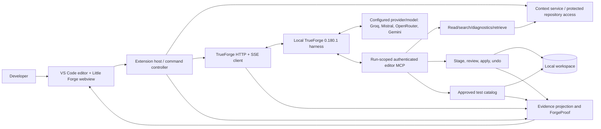
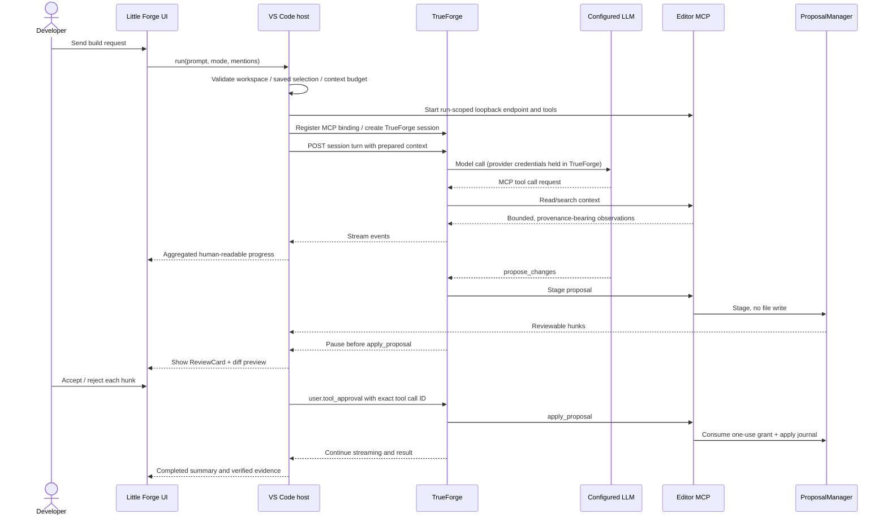

# 03 — Target System Architecture and Boundaries

## 1. High-level diagram



**Trust boundaries:** The model sees tool observations; it does not receive raw credentials or an unrestricted write primitive. The TrueForge harness owns model/tool loop and sessions. Little Forge owns editor UI, curated context, safe MCP execution, approval grants and evidence. The OS runs approved checks under the developer's user account; this is **not an OS sandbox**.

## 2. Ownership matrix

| Concern | TrueForge owns | Little Forge owns | Never do |
|---|---|---|---|
| Model requests | Provider adapter, tool-call turns, model execution | Selection and configuration of an already registered model | SDK calls to Groq/OpenRouter in VS Code host |
| Agent loop | Iteration, continuation, compaction, subagents when enabled | Constraints, tool policy, contextual hints, progress display | Parallel extension-side self-directed LLM loop |
| Tool protocol | MCP tool invocation and approval pause | MCP schemas, authentication, dispatch, side-effect controls | Expose raw arbitrary filesystem/shell tools |
| Context | Context management across turns | Workspace index, retrieval reasons, bounded tool observations | Assume long context guarantees correctness |
| Session | Harness persistent history and turn IDs | Short chat UI projection, optional evidence index | Duplicate harness session state as source of truth |
| Writes | Requires permission through harness | Final host approval, exact hunk selection, journaled apply | Write during proposal staging |
| Tests | Model chooses to request structured check through tool | User approves, restricted command executes, exit code captured | Claim unexecuted tests passed |
| Cancel | Receives explicit session cancel request | Immediately abort active run/revoke grants; cleanup local tasks | Reuse old approved grants after Stop |
| Credentials | Provider secrets in local harness | No raw keys; friendly provider/model labels only | Place keys in VSIX, workspace, analytics export |

## 3. Component architecture (target, staged migration)

```text
VS Code Extension Host
 ├─ WorkspaceController: workspace trust, root changes, dirty buffers
 ├─ ConversationController: user message + active run lifecycle
 ├─ ModelConfigService: query TrueForge configured model list
 ├─ TrueForgeAdapter: health/create/turn/SSE/reconnect/cancel/approvals
 ├─ AgentProfileFactory: chat/read-only plan/build/inline tool enablement
 ├─ ContextService: lexical index -> symbol map -> ranked evidence
 ├─ EditorMcpBridge: per-run server, bearer auth, token rotation
 ├─ ToolRouter: read/write/check gates and budgets
 ├─ ProposalService: existing ProposalManager and journals
 ├─ CheckService: existing CommandRunner, later named test profiles
 ├─ EvidenceProjector: normalized events -> progress + report receipts
 └─ WebviewBridge: versioned host messages, CSP, validation

Webview UI
 ├─ AppShell / WorkspaceHeader / ModelPicker
 ├─ ChatThread / MessageComposer / InlineSelectionChip
 ├─ ActivityCard (one aggregate card)
 ├─ ReviewCard / HunkDecisions / DiffLauncher
 ├─ ResultSummary / FilesChanged / Tests
 ├─ ContextDetails (collapsed)
 ├─ FlightRecorderDrawer (collapsed)
 └─ Settings / Empty / Error / Permission States
```

Keep the current monolithic `src/extension.ts` until P0 tests are stable; extract services incrementally and retain compatibility. A high-risk rewrite before the contest is prohibited.

## 4. Protocol and execution sequence



### Hard invariants

- **One active source-mutating run per workspace** initially. No concurrent apply/undo on same workspace; cross-window concurrency requires future explicit locking.
- New run → new MCP endpoint credentials and run ID. Old endpoint/tool grants cannot control a new run.
- Dirty VS Code target buffers must be saved before proposal/apply; source hash must match fresh disk bytes.
- Proposals are immutable snapshots. Selected hunk subset may be changed only by the user before approval.
- Tool approval must match exact session, thread, tool-call ID and proposal digest. Denial yields no write.
- Any file-level apply writes only after an authorized grant and keeps recoverable journal. Unsupported path/file types rejected.
- Connection errors with uncertain turn delivery require inspect/reconnect, never blind POST replay.
- A cancelled/failed session's late output is inert.
- Restore only files still matching accepted after-hash; otherwise report a conflict.

## 5. Repository and storage layout

**No new database for P0.** TrueForge's local SQLite holds its own session state; VS Code's `workspaceState/globalStorage` holds lightweight user transcript/checkpoints; ignored local `test-results` holds developer receipts. The webview is disposable and should rebuild from host-owned state. Never store a second copy of provider credentials.

Recommended privacy rule: evidence export opt-in, with full paths/source snippets removed or masked by default; local verbose receipts may contain source and should be explicitly reviewed before sharing.

## 6. Deployment topology

**Competition/local:** VS Code Extension Host + single TrueForge process on loopback (`127.0.0.1:8790`) + loopback authenticated editor MCP on ephemeral port + provider outbound traffic from the TrueForge process. No Docker, Redis, Postgres or hosted login needed.

**Possible future team product:** TrueForge hosted mode with explicit authentication and stronger governance. This requires separate architecture/security review: do **not** expose local no-auth harness on the public internet.

## 7. Architecture decision records (summary)

- **ADR-001:** TrueForge is the only agent loop (competition requirement, architectural separation).
- **ADR-002:** No provider SDK inside editor runtime; model credentials never leave TrueForge.
- **ADR-003:** Local MCP is run-scoped, bearer-protected, loopback-only.
- **ADR-004:** Review is mandatory for every source write; existing ProposalManager retained.
- **ADR-005:** Product UI uses progressive disclosure; advanced telemetry accessible but never default.
- **ADR-006:** No vector DB for P0; improve lexical/symbol retrieval and measure correctness.
- **ADR-007:** ForgeProof claims only actual measured events; no claim from model prose.
- **ADR-008:** Optional advanced TrueForge capabilities remain disabled until version-specific integration tests pass.
