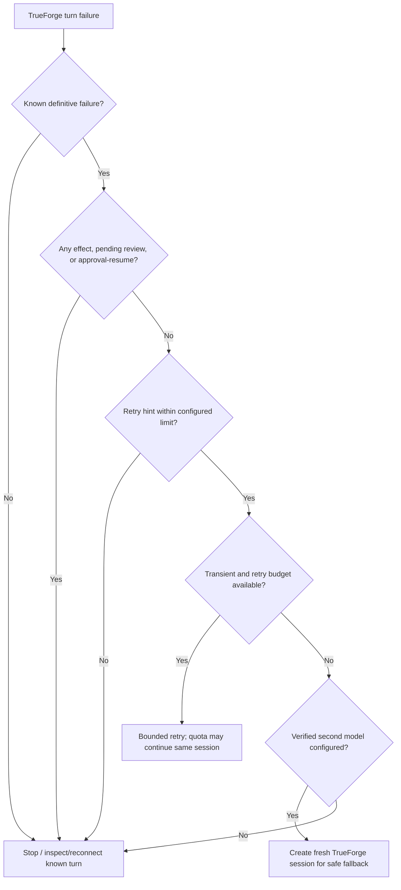

# 04 — TrueForge Integration, Multi-Model Strategy, and Fallback

## 1. Why TrueForge is central

TrueForge is the **agent execution harness**, not merely an LLM proxy. It owns the model/tool loop, MCP tool routing, persistent sessions, streamed events, approval pauses, and optional compaction/subagents/sandbox. Little Forge is its VS Code-native client plus permissioned editor tool surface. The source repository currently pins `@truefoundry/trueforge@0.180.1`. Any documented upstream feature from `main` must be tested against this pinned version before implementation; never paste latest SDK types into the pinned client without verification.

**Do not change:** all model calls flow VS Code → `ForgeClient` → local TrueForge → configured model provider. A model must never call the VS Code MCP endpoint directly from a separate custom SDK loop.

## 2. Current verified wire shapes (from `src/trueforge.ts`)

These paths are **current source-level implementation references**; revalidate against the installed harness before refactor.

| Purpose | Current endpoint / behavior |
|---|---|
| Harness health | `GET /healthz` |
| Registered model list | `GET /api/v1/models` |
| Register editor MCP server | `POST /api/v1/settings/mcp-servers` with remote manifest, auth headers |
| Create model+agent session | `POST /api/v1/sessions`, `agent.spec = agentSpec(...)` |
| Stream a turn | `POST /api/v1/sessions/:id/turns` with `{input, stream:true, previous_turn_id:'auto'}` |
| Inspect ambiguous turn | `GET /api/v1/sessions/:id/turns/:turnId` |
| Resume known turn stream | `GET /api/v1/sessions/:id/turns/:turnId/subscribe?after_sequence_number=N` |
| Cancel | `POST /api/v1/sessions/:id/cancel` |
| Approval reply | Next session input `{type:'user.tool_approval', thread_id,tool_call_id,approval}` |

**SSE discipline:** parse bounded frames, keep event sequence/cursor and observed turn ID, deduplicate repeats, reconnect only to an already-known turn, never blindly submit the same POST after ambiguous delivery. Normalize sanitized errors before displaying them. A stream closed during an unknown write outcome is a stop/inspect state, not automatic fallback.

## 3. Agent profiles

Use a *profile* to select which tools TrueForge makes available to a session. Profiles are not separate runtimes. Initial profiles:

| Profile | Allowed | Prohibited | User-visible purpose |
|---|---|---|---|
| Ask (P1) | map, search, read, symbols, context, diagnostics | propose, apply, command | Understand the codebase |
| Plan (P1) | Ask tools, optionally a `publish_plan` read-only event tool | source writes and commands | Produce structured implementation approach |
| Build / Agent (P0) | all 9 current editor tools | arbitrary shell, unapproved writes | Multi-file changes |
| Inline (P0) | 8 current tools excluding run_command; immutable selection scope | outside-selection edits, commands | Edit exactly selected code |
| Review (UI state) | Not a new LLM profile | no model-run bypass of approval | Inspect and choose hunks |

**Important:** A standalone Plan session does not magically transfer model memory into Build. If switching profiles creates a new TrueForge session, pass only a bounded, explicit, user-approved plan artifact and fresh context; disclose the transition in the activity trace. For P0, retain existing inline/agent only. Plan/Ask are P1 UX additions.

### Proposed task constraints in agent instruction

1. Discover top candidates; do not keep repeating identical broad searches.
2. After evidence is sufficient, identify source/test/docs roles and **prepare a proposal**.
3. Before proposing, `read_file` freshly and use `beforeHash` with exact replacements.
4. Never claim test success before real tool results.
5. Respect reviewer denials; don't re-stage rejected changes without a new request.
6. Prefer concise model output; details belong in trace data rather than long user prose.

Use a bounded exploration strategy rather than custom model-call orchestration. Any repeated-search detector in MCP may return a helpful **read-only** diagnostic (e.g., `duplicateQuery:true`, `previouslyObservedPaths:[...]`) and suggest a narrower tool call; it must not fabricate model decisions or run a second agent.

## 4. TrueForge capabilities: present, planned, and disabled

| Capability | Current status | Plan |
|---|---|---|
| HTTP sessions / SSE | Implemented | Harden normalized event projection, reconnect testing |
| Model switcher | Implemented from registered model list | Friendly labels + capability badges only in settings |
| MCP tool server | Implemented | Keep endpoint short-lived and auth-scoped |
| Approval checkpoints | Implemented | Retain exact tool-call correlation |
| Compaction | Enabled in current `agentSpec` | Observe whether triggered and validate long-task behavior |
| Dynamic subagents | Disabled | P2 only; TrueForge-managed, read-only specialists first |
| Sandbox as tool | Disabled | Future optional isolation; do not mistake for current command sandbox |
| Deferred tool loading | Disabled | Current 9 small schemas fit eager mode; benchmark before change |
| Code Mode | Disabled | P2 when proven effective and compatible |
| Generative UI | Disabled | Our native minimal webview is preferred |
| Skills | Not integrated | P2; confirm sandbox/version behavior |
| Scheduled agent | Not in scope | No unattended source edits |

Upstream docs: https://github.com/truefoundry/trueforge and https://trueforge.dev/. TrueForge upstream feature list changes; the pinned implementation is authoritative for release.

## 5. Provider configuration without direct provider code

User brings their own key; they enter it in **local TrueForge Settings → Models**. Little Forge obtains only registered provider/model names from `ForgeClient.health()` or a future capability endpoint, and never reads/provider-keys or records raw request headers. For a custom OpenAI-compatible provider, use TrueForge's catalog/custom connector, not a second HTTP client in VS Code.

### Candidate models (benchmark, do not declare a winner yet)

| Provider | Candidate model ID upstream | Why test | Risk |
|---|---|---|---|
| Groq | `openai/gpt-oss-120b` | Fast inference, tool use, reasoning | TPM/free quota can constrain multi-turn agent work |
| Groq | `qwen/qwen3.8-27b` | Alternative tool-calling behavior | Capacity/quality must be measured |
| Mistral | `mistral-small-latest` | Affordable tool-capable model | Exact alias and compatibility in account/harness |
| Mistral | `mistral-large-latest` | Quality comparison | Higher cost |
| Mistral | `devstral-latest` | Coding specialization comparison | Model availability and endpoint support |
| OpenRouter | A selected, pinned provider/model slug | Cross-vendor quality/cost benchmark | Availability, routing variation, billing risk |
| Google | Existing configured Flash-Lite | Known Task A reference | Recorded Task B iteration-limit failure |

**Never hard-code a current model catalog as a permanent feature**. Models and prices change. Record exact model ID, upstream provider, advertised context, supported effort/tool behavior, actual project rate limits and date tested in a local benchmark manifest.

Example provider endpoint documentation (configured inside TrueForge, not called by extension):

```text
Groq:        https://api.groq.com/openai/v1
OpenRouter:  https://openrouter.ai/api/v1
Mistral:     https://api.mistral.ai/v1
```

Before applying a configuration, test 1) basic prompt, 2) one read-only editor MCP roundtrip, 3) streaming, 4) approval pause/resume, 5) error handling, 6) actual Task A. Do not infer tool support from a marketing table alone.

## 6. Model capabilities and settings

Proposed configuration fields (extension-side nonsecret preferences only):

```ts
type ModelPreference = {
  selectedTrueForgeModelId: string;
  fallbackTrueForgeModelId?: string;
  reasoningEffort?: '' | 'low' | 'medium' | 'high';
  contextCapacityVerified: number;
  autoFallbackEnabled: boolean;   // default false until live proven
  maxEstimatedRunCostUsd?: number; // advisory budget warning unless harness has hard enforcement
};
```

- **Selected model:** frozen for a run; any automatic fallback logged with new exact identity.
- **Reasoning effort:** apply only if tested with the selected model and fallback model; otherwise omit and use provider default.
- **Context capacity:** explicitly verified; don't assume the advertised context can be consumed at free-tier TPM.
- **Cost cap:** unless TrueForge enforces one at the transport, show advisory threshold only and never claim a hard spend limit.
- **Model picker:** friendly `Groq · GPT‑OSS 120B` label; exact registered ID in advanced menu. Display “configured / not verified” honestly.
- **Fallback:** default off until a controlled live trial proves no replay of side effects.

## 7. Safe failure policy



Current `src/core/resilience.ts` caps automatic retry wait at 120 seconds and two client retries. Preserve conservative policy. Distinguish harness-internal transport retries from extension-level retries. Treat 401/403 as configuration failures, quota reset delays beyond cap as stop, unknown delivery as inspect, and source/command effects as no replay. Stop must cancel pending delay immediately.

### UI response to failures

- **Rate limit:** “This model is at its request limit. No unapproved changes were made.” CTA: Choose another configured model / View details.
- **Provider unavailable:** “Couldn’t reach the model. You can retry when it’s available.” Never promise automatic resumption if a turn is ambiguous.
- **Partial approved change:** “Some approved changes were already applied. Review report / Undo.” Do not claim workspace unchanged.
- **Harness down:** “TrueForge isn’t connected.” CTA: Open local setup. Do not ask for API key in extension.

## 8. Multi-model evaluation protocol

For each candidate model, create a fresh fixed Flask checkout, re-use exact `evaluation/tasks.json` prompts (no extra hints), and record:

- model/provider/alias, TrueForge version, agentSpec digest, timestamp, real account quota and reasoning effort;
- Task A correctness and exact docstring edge cases;
- Task B meaningful source/test/docs patch (not mere retrieved paths), tests and functional masked JSON;
- Task C no-change consistency with refused endpoint; approved fallback optionally a separate trial;
- total session turns, tool calls by name, repeated search ratio, time to first proposal, approval latency, emitted tokens when provider reports them, price estimate (with caveats), actual command exit codes;
- safety invariant violations (hard fail regardless of task score).

**Selection rule:** choose highest *verified* Task B completion and safety first; then average total task cost, latency, and provider stability. A model that finishes successfully in 12 turns beats a faster model that spins 32 turns and fails. Do not use unverified provider limits as a benchmark outcome.
