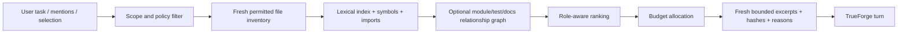

# 05 — Agent Workflows, Context Intelligence, and Progress Discipline

## 1. User-visible lifecycle

The primary experience must be a single conversation. Beneath the assistant's response, one compact task card transitions through *Understanding → Preparing changes → Review needed → Applying → Verifying → Complete*. Power users can open a full event timeline. The UI cannot simply display every MCP call as a separate chat bubble.

```mermaid
stateDiagram-v2
  [*] --> Idle
  Idle --> Connecting: User submits
  Connecting --> Exploring: TrueForge session active
  Exploring --> Planning: Evidence collected
  Planning --> Proposing: Model requests stage
  Proposing --> AwaitingReview: Proposal staged; harness pauses on apply
  AwaitingReview --> Applying: User approved selected hunks
  AwaitingReview --> Exploring: Rejected / model continues without write
  Applying --> Verifying: Apply returned success
  Verifying --> Completed: Evidence finalized
  Exploring --> Completed: Read-only task answered
  Connecting --> Failed: Connection failure
  Exploring --> Failed: Model failure
  Applying --> Failed: Partial recovery/conflict
  Connecting --> Cancelled: Stop
  Exploring --> Cancelled: Stop
  AwaitingReview --> Cancelled: Stop
  Verifying --> Cancelled: Stop
  Completed --> [*]
  Cancelled --> [*]
  Failed --> [*]
```



These are *display stages*, not extra client-side LLM orchestration. Derive progress from actual TrueForge events and MCP tool observations. Never fake “testing” unless a check is running or returned evidence.

## 2. Ask / Plan / Build / Inline modes

### Ask (P1)
- User asks question; tool list read-only.
- Retrieve source excerpts, cite file paths/line spans; no mutation proposals.
- Final response: concise answer + 2–4 sources, optional Context X-Ray link.

### Plan (P1)
- Read-only TrueForge session with source/search/diagnostics tools.
- Output a bounded plan object: goal, expected file roles, steps, risks, verification checks. File paths proposed by model are **hypotheses** until read.
- User can click “Build this”, which creates an authorized Build session using a compact plan artifact and **fresh workspace evidence**; model is not permitted to reuse stale hashes.
- Do not force Plan mode for every small edit; the default Build can proceed directly.

### Build (P0)
- Initial context selected automatically from user task (no file hints required).
- TrueForge agent explores as necessary, reads fresh hashes, stages a multi-file proposal.
- Human reviews; apply only accepted hunks through harness approval.
- Agent may request an allowlisted test; explicit separate approval required.
- Final response distinguishes “implemented” from “verified”.

### Inline (P0)
- The exact saved editor selection is immutable scope; direct selection content is provided without repository scan.
- Model may read file/related context only when needed, but `propose_changes` rejects hunks outside captured range even if model asks.
- Project commands unavailable in this mode.
- Native editor diff is source of truth for review, with a compact webview card as entry point.

## 3. Context Engine v2 — pipeline



### Indexing rules

- Re-use existing `Workspace` ignore rules, path normalization, symlink/hardlink defenses and protected file policy.
- Current caps: 2,500 files, 8 MiB indexing budget, 12 chunks, 12,000 conservative context-budget units, 512 KiB per read. Any changes to these must be tested for latency and safety.
- Index symbols and imports lexically first. Consider optional Tree-sitter only for supported languages once a measurable retrieval gap is shown; fallback gracefully for unknown languages.
- Avoid embeddings/vector DB in P0; require measured gains on an unseen repository before adding persistent semantic indexing.
- Recheck file inventory and hash before yielding read evidence; stale results are never treated as current source.
- Source content, `README`, tests, docs, config, imports, and user mentions have distinct ranking roles.

### Retrieval scoring proposal (research target, not existing formula)

```text
score(path) = lexical_match
            + symbol_match
            + dependency_relation
            + role_diversity_bonus
            + direct_mention_priority
            - redundant_context_penalty
```

Do not pretend a subjective 0–100 confidence percentage has statistical meaning. For UX, say *“Relevant because it declares the CLI group and is imported by the tests.”* If showing a score in advanced mode, label it **ranking score**, not correctness probability.

### Progressive context

1. **First pass:** short ranked overview: top source/test/docs plus a compact map, typically 3–6 excerpts.
2. **Agent follow-up:** `read_file` fresh exact ranges for implementation; search narrow symbols/globs.
3. **Pre-proposal:** verify candidate files and before-hashes; no changes from stale cached code.
4. **When insufficient:** show “Need more context” rather than hallucinate source content.
5. **When budget full:** return explicit truncation and recommendation to narrow reading; never silently drop explicit mentions.

Initial context should be smaller than the maximum simply because the model advertises a large context. Large unstructured context often wastes tokens and reduces focus.

## 4. How to break the Task B exploration loop

**Goal:** Improve the *model's behavior within TrueForge*, not build an extra agent runtime.

### Instrumentation

Track per tool: normalized input digest, timestamp, source hash, returned paths, returned bytes, whether new information was found, and whether a stage/approve step occurred. Keep this locally in evidence logs; do not display by default.

### Non-generative anti-loop feedback

- If the model repeats an identical `search_workspace` query against the same unchanged inventory, return a deterministic `duplicateQuery` hint and prior observation reference rather than rescanning/rewriting a huge result.
- If multiple identical reads occur, return the same result only when source hash is unchanged, but clearly label it as hash-confirmed; freshness must be preserved.
- If after a configurable number of consecutive read/search calls no new path or changed observation appears, show a **nonblocking suggestion** in the next read-tool result: “You have inspected X distinct files; consider preparing a proposal if evidence is sufficient.” Do not force a write or fabricate a model action.
- Keep a hard iteration cap and actual provider rate-limit handling. Do not raise the cap solely to allow loops.

### Agent instructions for meaningful multi-file tasks

- Discover source, tests and documentation independently.
- Before editing, briefly reason about the interfaces and required behavior.
- Stage a focused proposal once the relevant code is understood; don't exhaust the entire repository.
- After user approval, execute tests appropriate to the change.
- If tests fail, produce a *focused correction* based on test output rather than restarting broad search.
- If model cannot proceed, report uncertainty, missing information, and current clean/modified status.

### Measurements

- `distinctUsefulFilesRead / readCalls`
- `duplicateToolCallRatio`
- `timeToFirstProposalMs`
- `stageOccurred` (boolean)
- `verifiedTaskPass` (boolean)
- `iterationsUsed`
- `contextBudgetConsumed`

Compare exact Task B across controlled model/config changes. Never inject ground-truth solution files into the model prompt.

## 5. Context X-Ray (advanced drawer, P1)

**Purpose:** Transparent contextual grounding, not a wall of telemetry.

Top-level collapsed link: `Why these files?` underneath the activity card or final summary. On click:

- Files read, grouped by **Implementation**, **Tests**, **Docs**, **Config**.
- Reason for each selection: path/symbol match, import edge, paired test, explicit mention, or nearest relevant source.
- Line range and click-to-open source.
- Excluded/ignored policy summary without leaking hidden filenames or secrets.
- Budget progress only inside `Details → Context`, not default transcript.
- Clear distinction between “retrieved/read”, “proposed”, “changed” and “verified”; these are not interchangeable.

## 6. Mode-specific instruction templates

**Chat:** `Answer directly, cite permitted source paths and line numbers, do not modify files, do not invent reads.`

**Plan:** `Explore with read-only tools; produce concise plan and verification criteria; never call an effect tool.`

**Build:** `Discover relevant files without hints, read fresh hashes, stage focused multi-file changes, pause for approval, run only approved checks, summarize grounded outcomes.`

**Inline:** `Only modify text inside immutable selected range; read selected file fresh; no commands; stage before apply; user reviews every hunk.`

Templates are *specifications*; implement them via `agentSpec` and test with the pinned harness wire schema. The extension must not form a competing loop to execute them.

## 7. Conversation privacy and project switching

- Preserve a lightweight transcript in workspace state for UI continuity; avoid storing raw complete source context in message history.
- On workspace change: revoke old MCP run, dispose server, invalidate context, clear active proposal references, preserve only user-owned historical reports under their original workspace identity.
- Display workspace name in the header but not absolute path.
- If user sends a prompt that includes explicit `@file`, resolve against current permitted workspace and refuse ambiguous/missing mentions visibly.
- Never carry a model run from repo A into repo B without a new authenticated editor binding.
