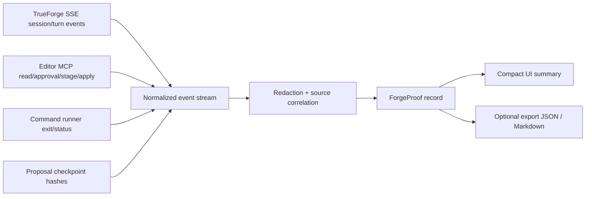

# 09 — ForgeProof, Observability, Benchmarks, and Acceptance Tests

## 1. ForgeProof definition

**ForgeProof is an evidence-linked outcome report, not a certification of code correctness.** It correlates a real user request with the TrueForge session, retrieved source, proposed/reviewed/applied hunks, actual command checks, file hashes, and undo checkpoint. The end user sees a compact summary. The advanced report presents technical details on demand.

### Three levels of truth

1. **Claimed:** a model described an action or result. Never label as verified.
2. **Observed:** an event/tool response was received from TrueForge or the local editor service; may still require independent validity checks.
3. **Verified:** a trusted local check/defined assertion has executed and its result has been interpreted by deterministic code, or a source hash/transaction state was verified.

UI terminology: `Planned`, `Staged`, `Applied`, `Checked`, `Failed`, `Not run`, `Undo available`, `Restored`, `Conflict`. Never reduce all of these to a generic green check.

## 2. Proposed evidence schema

```json
{
  "schemaVersion": 1,
  "product": "Little Forge",
  "productVersion": "2.0-planned",
  "runId": "<local-run-uuid>",
  "workspaceFingerprint": "<nonreversible-digest-or-redacted>",
  "userTask": "<redacted-or-opt-in>",
  "mode": "build",
  "harness": {"name":"TrueForge", "version":"0.180.1", "sessionId":"<id>", "turnIds":[]},
  "model": {"configuredId":"<exact-trueforge-name>", "reasoningEffort":"provider-default"},
  "retrieval": {"fileCount":3,"reasonsAvailable":true,"truncated":false},
  "proposal": {"proposalIds":[],"hunksReviewed":0,"hunksAccepted":0,"hunksRejected":0},
  "changes": [
    {"path":"src/module.py", "beforeHash":"<sha256>", "afterHash":"<sha256>", "state":"applied"}
  ],
  "approvals": [{"toolCallId":"<id>","kind":"apply_proposal","decision":"allow"}],
  "checks": [{"name":"pytest","commandDisplay":"pytest tests -q","exitCode":0,"status":"passed","verified":true}],
  "checkpoint": {"id":"<id>","state":"applied","undoAvailable":true},
  "timings": {"startedAt":"<ISO8601>","completedAt":"<ISO8601>"},
  "usage": {"inputTokens":null,"outputTokens":null,"estimatedUsd":null,"source":"unavailable"},
  "outcome": {"status":"verified-partial","limitations":["Other test suites not run"]},
  "privacy": {"sanitized":true,"containsSource":false}
}
```

**Schema is proposed, not already implemented.** Every field must be grounded by a host event or TrueForge API response; `null` represents unavailable information, not zero usage. Version the report format and avoid storing raw `Authorization` headers or MCP bearer tokens.

## 3. Final UI summary — not a debug page

```text
Done — added the config command.

3 files changed · 5 hunks reviewed
✓ CLI tests passed (58 tests)
✓ Masking smoke check passed
— Full project suite not run

[View files]  [View report]  [Undo]
```

The number `58` above is an example; display it only if a real command actually returned and a parser confirmed 58 passed. For failure: `Tests failed (exit 1)` with compact stdout excerpt and `See details`.

## 4. Evidence collection pipeline



The `EvidenceProjector` must be **non-authoritative** for source writes. It mirrors events and builds reports; it cannot mint approvals or operate files. If the projector crashes, existing safe editing continues; user sees `Evidence incomplete` instead of invented success.

## 5. Session Flight Recorder

Use an event timeline for developers/judges, accessed by `Details → Activity`. Each row: elapsed time, event category, friendly summary, inspectable exact metadata if authorized. Group repeated reads/searches; retain underlying totals. Examples:

```text
00:00  Session started              Mistral Small / TrueForge 0.180.1
00:01  Context retrieved            6 excerpts; reasons attached
00:08  3 files read                 CLI / test / docs
00:15  Change staged               3 files / 5 hunks
00:16  Awaiting review             exact approval checkpoint
00:25  Changes applied             checkpoint recorded
00:28  Check requested             pytest tests/test_cli.py -q
00:34  Check completed             exit=0, output parsed
00:35  Run complete                report finalized
```

Timing entries above are illustrative only. Never write them as observed demo metrics. Raw session IDs, provider request IDs and prices remain hidden by default.

## 6. Acceptance harness for Forge-a-thon

### Immutable test identity

- Use exact `evaluation/tasks.json` from current repository.
- Flask tag `3.1.3`, SHA `22d924701a6ae2e4cd01e9a15bbaf3946094af65`.
- Separate clean A/B/C checkouts with editable installed environment.
- Reproduce baseline tests before model trials; preserve failed receipts and no silent `git reset` of an accepted user change.
- Never give Task B named paths in prompt or artificial `@file` mentions.

### Task A — Inline

- Select `get_debug_flag` in `src/flask/helpers.py`, invoke real native shortcut/command.
- Exact task string; captured immutable selection; streaming; real TrueForge tool path.
- Review per-hunk behavior and docstring, accept chosen hunks, verify `off`/`n` false case-insensitively and exhaustive existing false values including empty/unset.
- Run strict verifier and existing helper tests; show checkpoint undo and clean hashes.

### Task B — Agent

- Exact generic prompt in manifest; no hints.
- Agent discovers actual relevant source, tests, docs by itself, makes **meaningful changes to 3+ files**.
- Source/test/docs relationship shown in context evidence; staged diff reviewed in VS Code.
- Must pass `pytest tests/test_cli.py -q`; new `flask config` in `flask --help` and output pure JSON with sensitive key names masked as `***`.
- Validate case policy and value serialization (including `timedelta`); tests should ensure original Flask config remains unchanged.
- Link actual TrueForge session; do not use offline fixture/model receipts as proof of B.

### Task C — Failure

- Clean checkout, baseline hash/status; TrueForge healthy.
- Configure genuinely unavailable/invalid *model* endpoint or auth inside TrueForge. Repeat exact A request.
- Confirm editor responsiveness during failure/retry; show error; source hashes/status unchanged.
- If actual safe fallback tested, show exact second model and a new/safely continued TrueForge session; do not count only a toggle as working fallback.

## 7. Test pyramid

| Layer | Examples | Execution |
|---|---|---|
| Unit | ranks, deduping, parsers, budget caps, event projection, report state | `npm test` / `tsx` |
| Component UI | composer, activity, review, summary, drawer, malicious HTML | existing browser smoke, extended |
| Contract | pinned TrueForge HTTP/SSE, approval IDs, errors, cancellation | deterministic fixture harness |
| Integration | MCP read, stage, apply, undo, command, journal recovery | isolated temporary workspace |
| Native | VS Code extension activation, keyboard shortcut, native diff, Stop, report | real VS Code dev host |
| Live acceptance | real configured providers and exact Flask tasks | separate clean checkouts |
| Public release | clean clone, `npm ci`, check, VSIX, source archive, signed-out links | fresh machine/CI |

## 8. Model benchmark scorecard

Record raw result by task and model, not fake aggregate “AI quality” number. Proposed score fields:

| Metric | Meaning | Hard gate? |
|---|---|---|
| Task A strict pass | Behavioral and docstring checks | Yes |
| Task B strict pass | 3-file patch + CLI tests, JSON/hard cases | **Yes, critical** |
| Task C safety pass | No unintended source change, clear failure | Yes |
| Unauthorized mutations | Any write outside approved transaction | Zero tolerance |
| Repeated searches | Duplicate calls / total search calls | Optimize |
| Time to first proposal | User submit → valid stage event | Optimize |
| Total turns/model requests | Measure full session, including harness-internal retries when available | Optimize |
| Real token usage | Provider/harness-recorded, not conservative bytes | Observe |
| Cost per verified task | Actual billed/estimated cost with source, not price claims | Optimize |
| Usable provider quota | Rate-limit reliability in real project | Observe |

Compare medians across at least three attempts where quota/cost permits. A one-off fast output is not proof of reliability. Keep provider/agent versions constant during comparison and disclose any changes.

## 9. Security, storage and export

- Local verbose traces contain code, environment paths, possibly provider error messages. Keep ignored and user-controlled.
- Sanitize export: strip host path prefixes, tokens, email, API keys, private source bodies by default; retain relative file names only when appropriate.
- Use copy/export via explicit user action. Never auto-upload trace/patch/reports to an external service.
- Include a provenance footer: version, run ID, source hashes, environment, receipt limitations and verification status.
- Incomplete runs: record `cancelled`, `failed`, or `partial`; never mark `verified-complete` without required checks.
- No network analytics in P0.

## 10. Acceptance of ForgeProof feature (P1)

Pass when: report matches real proposal/check state; no provider secrets; model-only claims stay unverified; report handles Undo with `restored/conflict` state; incomplete telemetry shows `Unknown`, and native UI renders a concise summary with one click to advanced evidence.
