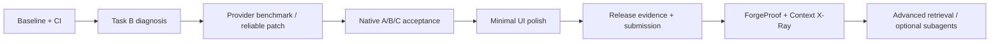

# 10 — Phase-wise Implementation Roadmap, Milestones, and Gates

**Critical dates:** 14 Nov 2026 planning baseline; registration by 15 Nov 2026; Round 1 by 20 Nov 2026 23:59 IST according to Techfest. The dates below are *priority sequencing*, not promises that engineering or judging is complete.

## Priority rules

1. Fix broken acceptance before building expansive new features.
2. Every phase is complete only when its tests and native verification pass.
3. Preserve a stable release branch/commit. Feature flags for experimental UX or models.
4. No new agent runtime, direct provider code, or hidden approvals.
5. Every merged change must keep `npm run check` passing locally and via CI when GitHub Actions is operational.

## Phase 0 — Lock baseline & competition compliance (P0, immediately)

**Objective:** Establish a reliable and safe branch before adding functionality.

**Tasks**
- Confirm team registration/status and actual competition deadline; finish account steps manually.
- Check `main` at known commit; run `npm ci && npm run check && npm run package` in clean local clone; record OS/Node/VS Code/TrueForge versions.
- Diagnose GitHub Actions `startup_failure` (not test failure). Inspect workflow YAML/plan permissions/environment and re-run. Do not claim green until a job executes successfully.
- Review source for keys, tokens, private traces, absolute paths, license claims; verify `REUSE.md` ancestry and notices.
- Make reviewed repository public only after manual approval and secret review; check signed-out access.
- Preserve a competition branch and a tag for last known passing version.

**Exit gates:** source clean clone builds and packages; exact harness version starts locally; two real smoke tools work; no secrets included; CI diagnosis documented. Failure of public access blocks submission, not local engineering.

## Phase 1 — Task B reliability and model tournament (P0, highest engineering priority)

**Objective:** Verified, meaningful, generalizable multi-file change.

**Tasks**
1. Extract/sanitize one failed local Task B TrueForge trace. Summarize repeated reads, time to first proposal, iteration exhaustion, context and provider errors.
2. Add lightweight correlation counters (run ID, tool call, digest, result size, distinct files) behind debug logging, not chat.
3. Fix any avoidable retrieval/protocol issues found; introduce non-generative duplicate search hints if needed.
4. Tune agent instructions to progress from discovery → fresh read → proposal. Maintain exact Task B prompt; no file hint injection.
5. Configure Groq GPT-OSS 120B and one Mistral tool-capable model **inside TrueForge** and verify one read-only MCP roundtrip and streaming per model. If quota/billing unavailable, record and continue with a usable provider; do not enter secrets into repo.
6. Compare Task B on clean pinned Flask checkouts; record exact provider, reasoning effort, turns, approvals, spend and failures.
7. Once one model stages meaningful source/test/docs patch, review and approve, run actual CLI checks and verify masked JSON/help.
8. Repeat on a fresh checkout (ideally same model) to show reliability, not a one-off.

**Exit gates:** `Task B = verified pass`; at least 3 meaningful files changed without hints; real TrueForge session recorded; checks pass. If not reached, do **not** spend effort on cosmetic extra modes.

## Phase 2 — Robustness and minimal UI refresh (P0)

**Objective:** Better user experience without jeopardizing safety.

**Tasks**
- Replace raw activity log presentation with one aggregated `TaskActivityCard`.
- Keep default chat visually quiet; remove visible token/budget info to drawer.
- Create concise `ReviewRequestCard` that links native diff; retain independent hunk controls.
- Create `ResultSummaryCard` with **actual** changed paths, verified checks, Undo and report link.
- Add robust status wording for `connecting`, `running`, `awaiting-review`, `failed`, `cancelled` and `completed`.
- Demonstrate physical inline shortcut and native mid-stream Stop, not merely fixture behavior.
- Test busy/idle transitions, model switching, fast SSE streams and failed retries.

**Exit gates:** Task A and C still pass native; safe Stop and no unapproved writes; UI smoke at 260px/sidebar and regular width; no regression in review transaction.

## Phase 3 — Evidence, hardening and submission freeze (P0)

**Objective:** Ship the **correct** competition package.

**Tasks**
- Freeze code and model configuration used for video; no new architecture changes after proof capture starts.
- Run A/B/C with actual installed extension/TrueForge in order. Ensure source SHA, fresh checkout and exact prompt each time.
- Record legible max-four-minute video with continuity between prompts and resulting edits; no pre-prepared patch substitution.
- Complete separate 1–3-page PDF with 8 required headings; list actual models, costs, team info, timestamps and limitations.
- Generate allowlisted source archive if useful; verify from clean clone and signed-out links. Keep long engineering dossier separate from official PDF.
- Submit via authorized Techfest portal account; preserve confirmation receipt.

**Exit gates:** public repo, public demo, correct short PDF, portal receipt, real A/B/C evidence. Without Task B pass, document partial result honestly.

## Phase 4 — Context X-Ray + ForgeProof (P1, after stable Round 1)

**Objective:** Distinctive trust-first product experience.

**Tasks**
- Introduce normalized event projection with strict schema and redaction.
- Build `ContextXRay` drawer with path reasons and selected/omitted context.
- Implement `ForgeProof` JSON + human-readable report, grounded from TrueForge/host/commands.
- Add Flight Recorder, grouped repetitive tool events, no raw telemetry in ordinary chat.
- Add read-only Plan profile with explicit build handoff; preserve user approval and fresh hashes.
- Add benchmark dashboard to *internal development UI*, not default user chat.

**Exit gates:** reproducible evidence; no false verification; privacy tests; user can find final outcome without opening debug drawer.

## Phase 5 — Structural retrieval + model management (P1/P2)

**Objective:** Scale and generalize beyond Flask.

**Tasks**
- Implement richer import/symbol/test relationship graph; compare against baseline retrieval on unseen repos (Python, TS, Go or Rust).
- Add optional Tree-sitter for languages where it measurably improves ranked retrieval, with lexical fallback.
- Advanced model capabilities view, safe fallback with live trial, transparent per-task cost reporting.
- Cache context index safely with mtime/hash validation; no hidden stale reads.
- Add opt-in named verification profiles, bounded output and source effect warnings.

**Exit gates:** measurable retrieval improvement without major latency regression; model portability tests; exact source security preserved.

## Phase 6 — Optional advanced harness features (P2)

**Objective:** Experiment without multiplying architecture risks.

**Candidates**
- TrueForge-managed read-only research subagents; benchmark against one-agent approach for tasks with independent components.
- Optional sandbox-as-tool for isolated checks; document credential/FS/network containment and limitations.
- TrueForge Skills where sandbox enabled and pin verified; no automatic unapproved source effects.
- Deferred tools and large-output offloading only if more than the current 9 tools justify it.
- Broader repo-knowledge memory under explicit privacy controls.

**Exit gates:** feature improves verified completion, cost or safety; no second orchestration loop; adequate logging and tests.

## 11. Suggested development workstreams / ownership

Assign by expertise rather than titles:

| Workstream | Main modules | Exit responsibility |
|---|---|---|
| TrueForge/API + models | `trueforge.ts`, harness, provider configs | Real tool roundtrips, Task B model benchmark |
| Context/agent effectiveness | `core/context.ts`, `tools.ts`, task traces | Correct multi-file discovery/proposal |
| Safety/verification | `core/proposals.ts`, `core/commands.ts`, tests | No unsafe edits, actual test evidence |
| UI/UX | `ui.js`, `ui.css`, `extension.ts` projection | Clean chat, review, summary, accessible states |
| Release/evidence | `evaluation/`, `submission/`, CI | Reproducible A/B/C, video, PDF, public links |

If a small team shares tasks, agree on APIs before parallel edits. Avoid two developers simultaneously rewriting `src/extension.ts`.

## 12. Dependencies and risk controls

### Must-not-slip gates

- Do not start the final video before Task B works in a native run.
- Do not switch providers during final task recording unless the switching is part of the documented demonstration.
- Do not claim a green CI status based on local 107-test report.
- Do not make the repository public before a secret/license/source review.
- Do not let custom UI writing bypass the existing review/approval logic.

## 13. Estimated scope (not a deadline promise)

Each phase carries unknowns—especially provider availability and Task B iteration behavior. Use proof-driven engineering rather than calendar-only estimates. A full P1/P2 product is **not realistically equivalent to a few days of competition preparation**. During Round 1, prioritize the smallest coherent vertical slice meeting all mandatory behavior.
