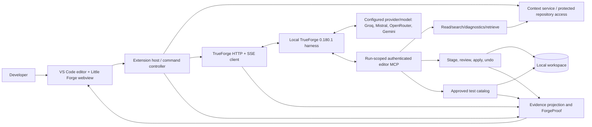
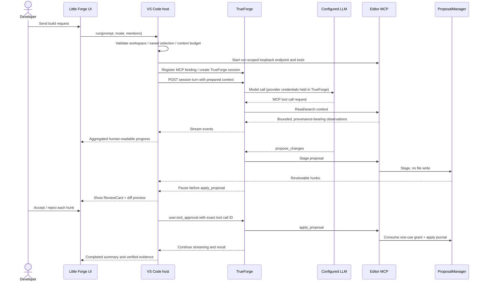
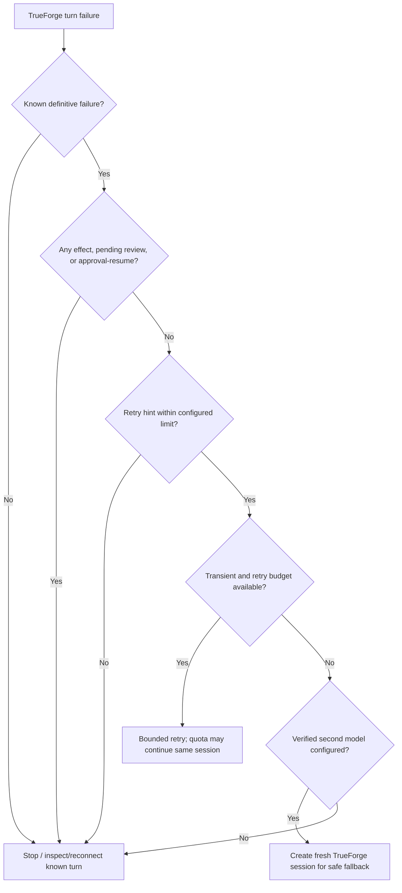
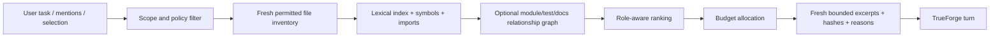
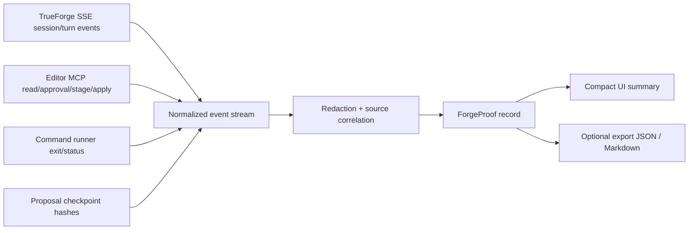
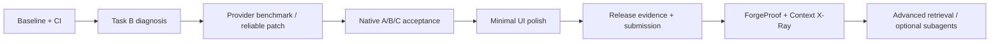

# LITTLE FORGE 2.0
## Complete Product, TrueForge, Architecture, Safety, UX and Implementation Blueprint

**Prepared 14 November 2026**  
**Repository:** https://github.com/priyanshu-1006/Little-Forge  
**Baseline commit:** `b252fc4d32139edcc8a2121e358a5742b7daec04`  
**Version:** Planning v1.0  

> This document combines the modular engineering specifications in the accompanying ZIP. The documents are intentionally detailed and distinguish existing implementation, proposed changes, and future research. They are not a claim that the full V2 product has been built.

---


<!-- SOURCE: README.md -->
# Little Forge 2.0 — Engineering Blueprint

**Version:** 1.0 planning baseline  
**Prepared:** 14 November 2026  
**Target:** TrueFoundry Forge-a-thon Round 1 + a sustainable post-competition product  
**Current repository:** https://github.com/priyanshu-1006/Little-Forge  
**Core product promise:** *Ask for a change. Watch clean progress. Approve it. Receive proof.*

> **Read this first.** This is a build specification, not a claim that all features exist. Sections and implementation tables label work as **Existing**, **Enhance**, **New**, or **Future**. The baseline is repository `main` at `b252fc4d32139edcc8a2121e358a5742b7daec04` (reviewed 14 November). No repository edits have been made as part of writing these documents.

## Non-negotiable engineering rules

1. **TrueForge owns every model call and the agent/tool execution loop.** The VS Code extension may prepare context, render UI, enforce permission decisions, execute its exposed MCP tools, and verify results. No Cline/Roo/Codex/Ollama/Groq SDK loop inside the extension.
2. **Human-owned source writes.** Every source mutation is a privately staged proposal; per-hunk review precedes a one-use approved apply. Keep existing `ProposalManager` transactions, guards, and checkpoint undo.
3. **A clean interface is a product requirement.** Default view = chat + concise progress + small changed-file summary + final report. Tool events, token counts, raw stack traces and retrieval budgets are available only through expandable details or an optional evidence view.
4. **Truthful evidence.** Model text is not proof. A pass must be derived from real execution, exit codes, clean source hashes, and correctly associated TrueForge session/tool identifiers.
5. **Benchmark before replacing known-good behavior.** Task A and C native rehearsals were documented; Task B remains unverified. Fix B before unnecessary architectural scope growth.
6. **No unsafe automatic retries.** Never replay ambiguous turns, pending approvals, commands, or applied edits. Credentials stay in local TrueForge, not source, VS Code storage or exported reports.
7. **Scope tiers matter.** Competition-critical features are marked **P0**. Production additions are **P1/P2**; they must not block the 20 November 2026 Round 1 submission.

## Document map

| Document | What it answers |
|---|---|
| `01_PRODUCT_PRD.md` | Product vision, users, use cases, scope, requirements, KPIs |
| `02_CURRENT_STATE_AND_GAP_MAP.md` | Exact existing modules, status, limitations, contest evidence |
| `03_TARGET_ARCHITECTURE.md` | End-to-end topology, boundaries, components, data flows and ADRs |
| `04_TRUEFORGE_AND_MODELS.md` | TrueForge API/harness, provider adapters, model tournament, quotas and fallback |
| `05_AGENT_WORKFLOWS_AND_CONTEXT.md` | Chat/Plan/Build/Review/Report lifecycle, progressive retrieval, stopping loops |
| `06_MCP_TOOLS_AND_SAFETY.md` | Tool contracts, approval rules, filesystem and command boundaries, undo and recovery |
| `07_UI_UX_DESIGN_SYSTEM.md` | Codex-inspired minimal design, layouts, states, microinteractions, accessible visuals |
| `08_UI_COMPONENT_AND_EVENT_SPEC.md` | UI tree, state machine, host/webview protocol, streaming aggregation, wireframes |
| `09_FORGEPROOF_AND_EVALUATION.md` | Evidence schema, acceptance, regression, benchmarks, measurements, security |
| `10_DELIVERY_ROADMAP.md` | Phase-by-phase implementation, dependencies, task owners, DoD and release gates |
| `11_ENGINEERING_STRUCTURE_AND_OPERATIONS.md` | Suggested directory layout, storage, CI, configuration, release and compatibility |
| `12_CODEX_TASK_BRIEFS.md` | Ordered copy-ready implementation briefs for Codex, with hard guardrails |
| `13_DECISIONS_RISKS_SOURCES.md` | Decision log, risks, exclusions, authoritative source register |
| `UI_REFERENCE.html` | **Optional interactive static UI reference.** No backend / no live agent connection. |

## Suggested reading path

- **Product/UI team:** 01 → 07 → 08 → 09 → 10
- **TrueForge/inference team:** 02 → 03 → 04 → 05 → 06 → 09
- **Coding agents (Codex):** 02 → 03 → 06 → 08 → 10 → 12
- **Demo/submission:** 02 → 09 → 10 → 13

## North-star interaction

1. Developer types: **“Add a masked JSON config command, its tests, and docs.”**
2. Little Forge shows one calm activity line: **“Understanding the CLI and tests…”**. Advanced telemetry stays hidden.
3. A few short human-readable updates appear: *Found 3 relevant areas* → *Preparing changes*.
4. When needed, a clear review surface appears: **“Review 3 files · 5 changes”**. Each hunk can be inspected and accepted/rejected independently.
5. The app applies only approved hunks, runs only specifically approved checks, and stays responsive.
6. Final message: **“Updated 3 files. CLI tests passed. Review details or undo.”** A full ForgeProof report is one click away.

## Competition time constraint

According to the Techfest event page: registration closes **15 Nov 2026**, Round 1 delivery is **20 Nov 2026 23:59 IST**. Required outputs: public repository, max-four-minute A/B/C demo, and 1–3-page PDF. Verify any organizer updates independently. The long docs here are development references, **not** the official short submission PDF.


---


<!-- SOURCE: 01_PRODUCT_PRD.md -->
# 01 — Product Requirements Document (PRD)

## 1. Product definition

**Name:** Little Forge 2.0.  
**Category:** Editor-native AI coding agent powered by a local TrueForge harness.  
**Personality:** Quietly competent, fast, comprehensible, professional.  
**Positioning:** **A trustworthy coding agent with reviewable changes and verifiable outcomes.**

Little Forge should feel like a clean Codex task conversation: a developer states an outcome, sees a focused progress narrative rather than a raw event log, reviews sensitive edits in context, and receives a concise summary plus evidence. Complex work stays behind details surfaces; the screen should not look like a developer console.

### Mission

Enable developers to understand and modify unfamiliar repositories safely, with model-agnostic intelligence via TrueForge, strong contextual grounding, explicit review, and reproducible verification.

### Product principles

| Principle | Product implication | Avoid |
|---|---|---|
| One primary action at a time | Composer → progress → review → summary | Five competing action bars |
| Progressive disclosure | Ordinary users see intent/outcome; power users expand evidence | Permanent token/cost/tool call dashboards |
| Human retains control | Explainable proposal before change; independently accept/reject | “AI applied 12 files automatically” without review |
| Truthful assistant | “Tests not run” when no test executed | “All good” based on a model guess |
| Graceful failure | Clear error and one useful recovery action | Raw SDK stack trace covering the chat |
| Inspectability | From a report, open precise source and session evidence | Hiding everything for sake of minimalism |
| Performance-conscious | Smooth streaming; non-blocking editor; cached views | Rebuilding an entire workspace every turn |
| Competition compliance | All model turns go through TrueForge | Shadow agent loop or direct provider calls |

## 2. Users and jobs-to-be-done

**Primary:** Student developer working on a 10–1,000-file project. Needs natural-language changes, confidence in file selections and simple reviews.  
**Secondary:** Experienced engineer reviewing a multi-file refactor. Needs exact diffs, proof, undo, reproducible tests, and provenance.  
**Tertiary:** Hackathon judge watching a short demonstration. Needs to see real TrueForge integration, correct multi-file autonomy, human-controlled review, retry/cancel consistency, and a compelling but not crowded UI.

### Core jobs

- “Explain where the authentication flow lives.” → **Ask**: explore, cite filenames, do not modify.
- “Plan a refactor without touching files.” → **Plan**: read-only investigation and a compact plan.
- “Change this selected function.” → **Inline**: immutable selection scope, staged patch, hunk review.
- “Build an additional CLI command with tests and docs.” → **Build**: autonomous discovery, multi-file proposal, review, approved verification.
- “I changed my mind.” → **Stop / Undo**: cancel in-flight work and undo previous accepted changes without destroying later manual edits.
- “What exactly changed?” → **Report**: concise human summary and detailed machine-verifiable evidence.

## 3. Scope by tier

### P0 — Competition release

- Functional VS Code extension; local TrueForge connection and model picker.
- Inline editing with exact selected-scope enforcement.
- Autonomous task with no file hints, true multi-file source/test/docs proposal.
- Explainable, bounded context retrieval; `@file`, `@symbol` when explicitly used.
- Real TrueForge MCP tools, SSE streaming, approval pauses and safe cancellation.
- Independent hunk review, native diff, accepted changes, safe undo.
- Approved checks (`pytest`, `npm test`, typecheck, git diff check).
- Basic resilient retry/error behavior; no unsafe model replay.
- Minimal UI pass: clean chat, concise activity, review card, final summary.
- Real acceptance against fixed Flask A/B/C tasks; public code, video, short PDF.

### P1 — Distinctive polished product

- **Context X-Ray**: provenance, relevance rationale, selected/omitted evidence, accessible on demand.
- **ForgeProof**: verified result report linked to session, hunks and checks.
- **Flight Recorder**: timeline of model/tools/approvals/errors, collapsed by default.
- Structured read-only Plan mode (different TrueForge agent configuration, not separate runtime).
- Generalized repository relationship index, language-aware symbol extraction when proven useful.
- Multi-provider benchmark/fallback policy and cost audit.
- Beautiful theme-aware interface with robust keyboard, motion, empty and error states.

### P2 — Future exploration

- TrueForge-managed subagents for parallel independent analysis; measure benefit before shipping.
- Optional TrueForge sandbox-as-tool for isolated approved checks; explicit trust boundary and session linkage.
- Skills when tested with the chosen sandbox/runtime; dynamic tool loading only if tool count warrants it.
- Multi-repo workspaces, deeper AST/dependency graph, indexed historical knowledge.
- Reproducible shareable reports and optional team workflows (never needed for P0).

### Explicit non-goals

Standalone Code-OSS desktop shell, inline autocomplete, Git hosting replacement, model training, autonomous deployment, hosted accounts/database, tab-completion competitor, background unapproved edits, a custom orchestration runtime, arbitrary shell execution, hidden model charges, public publication of source or traces without developer approval.

## 4. Functional requirement catalog

| ID | Requirement | Priority | Acceptance |
|---|---|---|---|
| FR-01 | Connect to local TrueForge | P0 | Version/health/models shown; API keys not stored in extension |
| FR-02 | Select configured model | P0 | Selected model frozen per run; unsupported provider errors clear |
| FR-03 | Chat and ask | P1 | Read-only response grounded in permitted workspace, no writes |
| FR-04 | Selection-scoped inline edit | P0 | Outside-selection modifications rejected independent of model |
| FR-05 | Autonomous multi-file task | P0 | No hints; touches meaningful source, tests, docs; passes verifier |
| FR-06 | Context provenance | P0 basic / P1 rich | Files, reason, and capped budget inspectable |
| FR-07 | Streaming | P0 | Visible incremental updates without blocking editor |
| FR-08 | Cancel | P0 | Immediate local grant revocation, remote cancellation attempt, no late writes |
| FR-09 | Stage changes privately | P0 | No working tree mutation until user approval |
| FR-10 | Per-hunk decisions | P0 | Each hunk independent; preview matches chosen subset |
| FR-11 | Undo accepted change | P0 | Restore only expected hashes; flag conflicts |
| FR-12 | Approved test execution | P0 | Ask first; surface actual exit code and stdout summary |
| FR-13 | Clean final summary | P0 UI | Changed files / tests / limitations and undo action |
| FR-14 | ForgeProof report | P1 | Complete source and session evidence, privacy redaction |
| FR-15 | Read-only Plan workflow | P1 | No write/command MCP tools available in Plan |
| FR-16 | Provider fallback | P1 | Only safe pre-effect fallback, verified live with second model |
| FR-17 | Themes/accessibility | P0 baseline / P1 polish | Dark/light, keyboard, reduced motion, narrow views |
| FR-18 | Model benchmark runner | P0 internal / P1 UI | Exact task/commit/prompt, runs tagged, no false success |

## 5. Nonfunctional requirements and targets

**Targets, not current measurements.**

- Main webview cold-open visual response: target <600 ms on a typical student laptop; measure VS Code extension-host performance.
- Streaming text appears progressively without per-token full DOM replacement; target responsive interaction during model stalls.
- Button feedback within one frame; progress updates coalesced at ~60–150 ms, not raw every token.
- Context budget bounded by configured verified model capacity, including output reserve and serialization overhead.
- No outbound model traffic initiated by extension; only localhost TrueForge API traffic from client.
- No accidental file changes when a run is cancelled, rejected, expired, or the model endpoint fails.
- Every exported report includes explicit `verified` / `unverified` status for each claim.
- Any P0 workflow must have automated tests and one actual native VS Code rehearsal.

## 6. UX acceptance and success metrics

- **Clarity:** In 5 seconds a user can identify current task and whether action is required.
- **Minimalism:** Default task transcript shows at most one active progress card, plus concise milestone lines; no exposed token counts.
- **Control:** Review/Cancel/Undo always reachable within two user actions when relevant.
- **Accessibility:** All controls keyboard operable; focus visible; screen-reader live regions for status; no essential animation-only communication.
- **Task quality:** Completion rate on fixed Tasks A/B/C, with a separate score for correctness and verified evidence.
- **Agent efficiency:** Steps to first meaningful proposal, repeated tool calls, input/output tokens, elapsed time, rate-limit failures, cost per successful task.
- **Reliability:** Zero unauthorized source writes in cancellation/approval attack tests; restore conflicts surfaced, never silently overwritten.

## 7. Product voice and microcopy rules

- Prefer **“Reading the CLI files…”** over “Invoking MCP server function 04”.
- Prefer **“Ready for your review: 3 files”** over “Tool approval required thread x87”.
- Prefer **“Tests passed: 58”** only when validated command output reports exactly that; otherwise **“Checks completed”**.
- Prefer **“Couldn’t reach the model. No files were changed.”** over an exception dump.
- Don’t claim **“Secure/verified/no-risk”** unless the claim is scoped to observed checks.
- Don’t show cryptic provider IDs in the default transcript. In a menu/header show a friendly model name, while the exact ID stays inspectable.

## 8. Definition of success

A new developer can install the VSIX, connect the local TrueForge harness, choose a model, request a multi-file change, see intelligible progress, review proposed edits, run approved verification, and receive a report of what was actually done. The whole flow functions even when streaming fails, the user stops, or the model quota is exhausted—without losing control over source.


---


<!-- SOURCE: 02_CURRENT_STATE_AND_GAP_MAP.md -->
# 02 — Current State, Repository Inventory, and Gaps

## 1. Ground-truth baseline

Reviewed repository: `priyanshu-1006/Little-Forge`, `main` SHA `b252fc4d32139edcc8a2121e358a5742b7daec04`, private at review time. Current package version: `0.1.0`. Runtime: VS Code `^1.96.0`, Node `>=22.14.0`, TrueForge `0.180.1`, MCP SDK `1.26.0`, TypeScript `5.9.3`, `esbuild`, plain JS/CSS webview. The repository's local verification document **reports** 107 passing tests; these were not rerun in this documentation session. Two accessible GitHub Actions runs were `startup_failure` with no jobs returned. Do not mark CI healthy.

### Existing file ownership

| File | Responsibility today | V2 direction |
|---|---|---|
| `src/extension.ts` | VS Code activation, webview host, model setup, run state, approval, stop, diff, undo | Refactor into controllers gradually; maintain behavior |
| `src/trueforge.ts` | Local HTTP/SSE client, `agentSpec`, retries, approvals and session APIs | Add normalized event projection, capabilities/telemetry, contract tests |
| `src/mcp-server.ts` | Authenticated loopback MCP tools; Zod schemas | Preserve, extend only when justified |
| `src/tools.ts` | MCP dispatch, active-run guards, read hashes, one-use grants | Extract read tools and effects services if complexity grows |
| `src/core/workspace.ts` | Workspace inventory, ignored/protected paths, safe reads/search | Keep safety rules and limits |
| `src/core/context.ts` | Deterministic lexical retrieval, symbol/import associations, `@mentions`, provenance | Add better graph/plan-aware retrieval, query deduplication |
| `src/core/proposals.ts` | Immutable staging, hunk decisions, apply transactions, checkpoints, rollback | Preserve; add evidence hooks without weakening invariant |
| `src/core/commands.ts` | Approved structured checks and process handling | Extend only via catalog and test |
| `src/core/resilience.ts` | Bounded retries, failure classification, abortable waits | Expand provider-specific safe classification, metrics |
| `src/ui.js`, `src/ui.css` | Agent webview transcript, context, review, approvals, checkpoints | Redesign as minimal chat-first UI; migrate to components in stages |
| `evaluation/`, `tests/` | Fixed Flask tasks, unit/integration acceptance harness | Make reproducible multi-model experiment matrix |
| `.github/workflows/ci.yml` | Typecheck/test/build job | Resolve startup failure, add trusted local reproduction |

### Confirmed/recorded behavior versus unverified

| Capability | Evidence status | Owner implication |
|---|---|---|
| TrueForge HTTP/SSE via 0.180.1 | Source code + fixture/native reports | Freeze wire contract until verified |
| Authenticated MCP and approvals | Tests + harness fixture reports | Keep explicit review boundary |
| Task A inline, hunk review, undo | Recorded native real-model rehearsal, 42/42 strict checks, 35 helper tests | Capture final continuous video |
| Task B 3-file autonomous patch | **Not passed**: models exhausted exploration steps without staging | Highest-priority P0 failure |
| Task C model failure / unchanged source | Recorded native refused-endpoint rehearsal, 235 hashes unchanged | Show in final demo |
| Real native mid-stream Stop | Not fully proven | Dedicated live test |
| Second configured model fallback | Code path exists, not live proven | Do not claim performance or resiliency points |
| Open-source compliance | REUSE/third-party notices present; full publication audit pending | Review before public release |
| CI | Two startup failures; no verified green jobs | Fix run startup and permissions |
| Marketplace/release | VSIX script exists; no public release shown | Not required for Round 1 |

## 2. Why Task B is not solved

The static retrieval evaluation selected the expected implementation/test/docs areas, but real-model B sessions reportedly spent their 32 allowed iterations on research and repeated searches without a meaningful patch. The proper working hypothesis is *insufficient transition control from discovery to proposal*, **not** proof that a particular model is bad. The detailed local `test-results/live-B-.../receipt.json` traces are ignored by Git; obtain sanitized data before choosing a fix.

### Required diagnosis protocol

1. Parse real TrueForge session/tool events for a failed B run (locally only).
2. Build a timeline: initial context → tool names/args → result sizes → repeated reads → moment of decision/action.
3. Determine whether commands were repeatedly requested before a proposal, whether source hash reads occurred, and where remaining iteration budget was consumed.
4. Benchmark unchanged code on a second model only after a known minimal trace analysis.
5. Introduce one change at a time: progressive context, better instructions, anti-loop tool feedback, model choice, or tool schema simplification.
6. Repeat exact fixed B with no file hints, same Flask commit, clean checkout and recorded model settings.

### What we should NOT do

- Hard-code `src/flask/cli.py` / `tests/test_cli.py` / `docs/cli.rst` into production prompt or retrieval.
- Replace TrueForge's loop with an ad hoc extension-side planner that repeatedly calls providers.
- Raise iteration limits to 100 as a first response.
- Label retrieval-only coverage as Task B completion.
- Add multiple LLM agents, a vector DB, or new cloud infrastructure before baseline B passes.

## 3. Keep and strengthen

**Keep:** per-hunk immutable proposals; single-use grants; journaled apply; conflict-aware undo; selection scope; path protection; local-only harness; tool-side observation caps; SSE disconnect ambiguity handling; strict model-credential placement.

**Strengthen:** semantic test relationships, repeated-tool-call detection, model trial reproducibility, review UX, progress wording, evidence linking, minimal UI, public build verification, and CI.

## 4. Competition acceptance gate

- Public GitHub source reachable signed out.
- Real TrueForge session: no direct provider or shadow loop in extension.
- Fixed Flask `3.1.3` source SHA `22d924701a6ae2e4cd01e9a15bbaf3946094af65`.
- Task A live selection → approved code/docstring → verifier and undo.
- Task B fully autonomous *meaningful* source/test/docs patch → review → `pytest tests/test_cli.py -q` and functional `flask config` JSON masking.
- Task C genuine model endpoint failure while harness remains healthy → responsive editor, unchanged source.
- Final A/B/C max-four-minute demonstration + separate 1–3-page write-up; all timestamps grounded in the exported video.


---


<!-- SOURCE: 03_TARGET_ARCHITECTURE.md -->
# 03 — Target System Architecture and Boundaries

## 1. High-level diagram



**Trust boundaries:** The model sees tool observations; it does not receive raw credentials or an unrestricted write primitive. The TrueForge harness owns model/tool loop and sessions. Little Forge owns editor UI, curated context, safe MCP execution, approval grants and evidence. The OS runs approved checks under the developer's user account; this is **not an OS sandbox**.

## 2. Ownership matrix

| Concern | TrueForge owns | Little Forge owns | Never do |
|---|---|---|---|
| Model requests | Provider adapter, tool-call turns, model execution | Selection and configuration of an already registered model | SDK calls to Groq/OpenRouter in VS Code host |
| Agent loop | Iteration, continuation, compaction, subagents when enabled | Constraints, tool policy, contextual hints, progress display | Parallel extension-side self-directed LLM loop |
| Tool protocol | MCP tool invocation and approval pause | MCP schemas, authentication, dispatch, side-effect controls | Expose raw arbitrary filesystem/shell tools |
| Context | Context management across turns | Workspace index, retrieval reasons, bounded tool observations | Assume long context guarantees correctness |
| Session | Harness persistent history and turn IDs | Short chat UI projection, optional evidence index | Duplicate harness session state as source of truth |
| Writes | Requires permission through harness | Final host approval, exact hunk selection, journaled apply | Write during proposal staging |
| Tests | Model chooses to request structured check through tool | User approves, restricted command executes, exit code captured | Claim unexecuted tests passed |
| Cancel | Receives explicit session cancel request | Immediately abort active run/revoke grants; cleanup local tasks | Reuse old approved grants after Stop |
| Credentials | Provider secrets in local harness | No raw keys; friendly provider/model labels only | Place keys in VSIX, workspace, analytics export |

## 3. Component architecture (target, staged migration)

```text
VS Code Extension Host
 ├─ WorkspaceController: workspace trust, root changes, dirty buffers
 ├─ ConversationController: user message + active run lifecycle
 ├─ ModelConfigService: query TrueForge configured model list
 ├─ TrueForgeAdapter: health/create/turn/SSE/reconnect/cancel/approvals
 ├─ AgentProfileFactory: chat/read-only plan/build/inline tool enablement
 ├─ ContextService: lexical index -> symbol map -> ranked evidence
 ├─ EditorMcpBridge: per-run server, bearer auth, token rotation
 ├─ ToolRouter: read/write/check gates and budgets
 ├─ ProposalService: existing ProposalManager and journals
 ├─ CheckService: existing CommandRunner, later named test profiles
 ├─ EvidenceProjector: normalized events -> progress + report receipts
 └─ WebviewBridge: versioned host messages, CSP, validation

Webview UI
 ├─ AppShell / WorkspaceHeader / ModelPicker
 ├─ ChatThread / MessageComposer / InlineSelectionChip
 ├─ ActivityCard (one aggregate card)
 ├─ ReviewCard / HunkDecisions / DiffLauncher
 ├─ ResultSummary / FilesChanged / Tests
 ├─ ContextDetails (collapsed)
 ├─ FlightRecorderDrawer (collapsed)
 └─ Settings / Empty / Error / Permission States
```

Keep the current monolithic `src/extension.ts` until P0 tests are stable; extract services incrementally and retain compatibility. A high-risk rewrite before the contest is prohibited.

## 4. Protocol and execution sequence



### Hard invariants

- **One active source-mutating run per workspace** initially. No concurrent apply/undo on same workspace; cross-window concurrency requires future explicit locking.
- New run → new MCP endpoint credentials and run ID. Old endpoint/tool grants cannot control a new run.
- Dirty VS Code target buffers must be saved before proposal/apply; source hash must match fresh disk bytes.
- Proposals are immutable snapshots. Selected hunk subset may be changed only by the user before approval.
- Tool approval must match exact session, thread, tool-call ID and proposal digest. Denial yields no write.
- Any file-level apply writes only after an authorized grant and keeps recoverable journal. Unsupported path/file types rejected.
- Connection errors with uncertain turn delivery require inspect/reconnect, never blind POST replay.
- A cancelled/failed session's late output is inert.
- Restore only files still matching accepted after-hash; otherwise report a conflict.

## 5. Repository and storage layout

**No new database for P0.** TrueForge's local SQLite holds its own session state; VS Code's `workspaceState/globalStorage` holds lightweight user transcript/checkpoints; ignored local `test-results` holds developer receipts. The webview is disposable and should rebuild from host-owned state. Never store a second copy of provider credentials.

Recommended privacy rule: evidence export opt-in, with full paths/source snippets removed or masked by default; local verbose receipts may contain source and should be explicitly reviewed before sharing.

## 6. Deployment topology

**Competition/local:** VS Code Extension Host + single TrueForge process on loopback (`127.0.0.1:8790`) + loopback authenticated editor MCP on ephemeral port + provider outbound traffic from the TrueForge process. No Docker, Redis, Postgres or hosted login needed.

**Possible future team product:** TrueForge hosted mode with explicit authentication and stronger governance. This requires separate architecture/security review: do **not** expose local no-auth harness on the public internet.

## 7. Architecture decision records (summary)

- **ADR-001:** TrueForge is the only agent loop (competition requirement, architectural separation).
- **ADR-002:** No provider SDK inside editor runtime; model credentials never leave TrueForge.
- **ADR-003:** Local MCP is run-scoped, bearer-protected, loopback-only.
- **ADR-004:** Review is mandatory for every source write; existing ProposalManager retained.
- **ADR-005:** Product UI uses progressive disclosure; advanced telemetry accessible but never default.
- **ADR-006:** No vector DB for P0; improve lexical/symbol retrieval and measure correctness.
- **ADR-007:** ForgeProof claims only actual measured events; no claim from model prose.
- **ADR-008:** Optional advanced TrueForge capabilities remain disabled until version-specific integration tests pass.


---


<!-- SOURCE: 04_TRUEFORGE_AND_MODELS.md -->
# 04 — TrueForge Integration, Multi-Model Strategy, and Fallback

## 1. Why TrueForge is central

TrueForge is the **agent execution harness**, not merely an LLM proxy. It owns the model/tool loop, MCP tool routing, persistent sessions, streamed events, approval pauses, and optional compaction/subagents/sandbox. Little Forge is its VS Code-native client plus permissioned editor tool surface. The source repository currently pins `@truefoundry/trueforge@0.180.1`. Any documented upstream feature from `main` must be tested against this pinned version before implementation; never paste latest SDK types into the pinned client without verification.

**Do not change:** all model calls flow VS Code → `ForgeClient` → local TrueForge → configured model provider. A model must never call the VS Code MCP endpoint directly from a separate custom SDK loop.

## 2. Current verified wire shapes (from `src/trueforge.ts`)

These paths are **current source-level implementation references**; revalidate against the installed harness before refactor.

| Purpose | Current endpoint / behavior |
|---|---|
| Harness health | `GET /healthz` |
| Registered model list | `GET /api/v1/models` |
| Register editor MCP server | `POST /api/v1/settings/mcp-servers` with remote manifest, auth headers |
| Create model+agent session | `POST /api/v1/sessions`, `agent.spec = agentSpec(...)` |
| Stream a turn | `POST /api/v1/sessions/:id/turns` with `{input, stream:true, previous_turn_id:'auto'}` |
| Inspect ambiguous turn | `GET /api/v1/sessions/:id/turns/:turnId` |
| Resume known turn stream | `GET /api/v1/sessions/:id/turns/:turnId/subscribe?after_sequence_number=N` |
| Cancel | `POST /api/v1/sessions/:id/cancel` |
| Approval reply | Next session input `{type:'user.tool_approval', thread_id,tool_call_id,approval}` |

**SSE discipline:** parse bounded frames, keep event sequence/cursor and observed turn ID, deduplicate repeats, reconnect only to an already-known turn, never blindly submit the same POST after ambiguous delivery. Normalize sanitized errors before displaying them. A stream closed during an unknown write outcome is a stop/inspect state, not automatic fallback.

## 3. Agent profiles

Use a *profile* to select which tools TrueForge makes available to a session. Profiles are not separate runtimes. Initial profiles:

| Profile | Allowed | Prohibited | User-visible purpose |
|---|---|---|---|
| Ask (P1) | map, search, read, symbols, context, diagnostics | propose, apply, command | Understand the codebase |
| Plan (P1) | Ask tools, optionally a `publish_plan` read-only event tool | source writes and commands | Produce structured implementation approach |
| Build / Agent (P0) | all 9 current editor tools | arbitrary shell, unapproved writes | Multi-file changes |
| Inline (P0) | 8 current tools excluding run_command; immutable selection scope | outside-selection edits, commands | Edit exactly selected code |
| Review (UI state) | Not a new LLM profile | no model-run bypass of approval | Inspect and choose hunks |

**Important:** A standalone Plan session does not magically transfer model memory into Build. If switching profiles creates a new TrueForge session, pass only a bounded, explicit, user-approved plan artifact and fresh context; disclose the transition in the activity trace. For P0, retain existing inline/agent only. Plan/Ask are P1 UX additions.

### Proposed task constraints in agent instruction

1. Discover top candidates; do not keep repeating identical broad searches.
2. After evidence is sufficient, identify source/test/docs roles and **prepare a proposal**.
3. Before proposing, `read_file` freshly and use `beforeHash` with exact replacements.
4. Never claim test success before real tool results.
5. Respect reviewer denials; don't re-stage rejected changes without a new request.
6. Prefer concise model output; details belong in trace data rather than long user prose.

Use a bounded exploration strategy rather than custom model-call orchestration. Any repeated-search detector in MCP may return a helpful **read-only** diagnostic (e.g., `duplicateQuery:true`, `previouslyObservedPaths:[...]`) and suggest a narrower tool call; it must not fabricate model decisions or run a second agent.

## 4. TrueForge capabilities: present, planned, and disabled

| Capability | Current status | Plan |
|---|---|---|
| HTTP sessions / SSE | Implemented | Harden normalized event projection, reconnect testing |
| Model switcher | Implemented from registered model list | Friendly labels + capability badges only in settings |
| MCP tool server | Implemented | Keep endpoint short-lived and auth-scoped |
| Approval checkpoints | Implemented | Retain exact tool-call correlation |
| Compaction | Enabled in current `agentSpec` | Observe whether triggered and validate long-task behavior |
| Dynamic subagents | Disabled | P2 only; TrueForge-managed, read-only specialists first |
| Sandbox as tool | Disabled | Future optional isolation; do not mistake for current command sandbox |
| Deferred tool loading | Disabled | Current 9 small schemas fit eager mode; benchmark before change |
| Code Mode | Disabled | P2 when proven effective and compatible |
| Generative UI | Disabled | Our native minimal webview is preferred |
| Skills | Not integrated | P2; confirm sandbox/version behavior |
| Scheduled agent | Not in scope | No unattended source edits |

Upstream docs: https://github.com/truefoundry/trueforge and https://trueforge.dev/. TrueForge upstream feature list changes; the pinned implementation is authoritative for release.

## 5. Provider configuration without direct provider code

User brings their own key; they enter it in **local TrueForge Settings → Models**. Little Forge obtains only registered provider/model names from `ForgeClient.health()` or a future capability endpoint, and never reads/provider-keys or records raw request headers. For a custom OpenAI-compatible provider, use TrueForge's catalog/custom connector, not a second HTTP client in VS Code.

### Candidate models (benchmark, do not declare a winner yet)

| Provider | Candidate model ID upstream | Why test | Risk |
|---|---|---|---|
| Groq | `openai/gpt-oss-120b` | Fast inference, tool use, reasoning | TPM/free quota can constrain multi-turn agent work |
| Groq | `qwen/qwen3.8-27b` | Alternative tool-calling behavior | Capacity/quality must be measured |
| Mistral | `mistral-small-latest` | Affordable tool-capable model | Exact alias and compatibility in account/harness |
| Mistral | `mistral-large-latest` | Quality comparison | Higher cost |
| Mistral | `devstral-latest` | Coding specialization comparison | Model availability and endpoint support |
| OpenRouter | A selected, pinned provider/model slug | Cross-vendor quality/cost benchmark | Availability, routing variation, billing risk |
| Google | Existing configured Flash-Lite | Known Task A reference | Recorded Task B iteration-limit failure |

**Never hard-code a current model catalog as a permanent feature**. Models and prices change. Record exact model ID, upstream provider, advertised context, supported effort/tool behavior, actual project rate limits and date tested in a local benchmark manifest.

Example provider endpoint documentation (configured inside TrueForge, not called by extension):

```text
Groq:        https://api.groq.com/openai/v1
OpenRouter:  https://openrouter.ai/api/v1
Mistral:     https://api.mistral.ai/v1
```

Before applying a configuration, test 1) basic prompt, 2) one read-only editor MCP roundtrip, 3) streaming, 4) approval pause/resume, 5) error handling, 6) actual Task A. Do not infer tool support from a marketing table alone.

## 6. Model capabilities and settings

Proposed configuration fields (extension-side nonsecret preferences only):

```ts
type ModelPreference = {
  selectedTrueForgeModelId: string;
  fallbackTrueForgeModelId?: string;
  reasoningEffort?: '' | 'low' | 'medium' | 'high';
  contextCapacityVerified: number;
  autoFallbackEnabled: boolean;   // default false until live proven
  maxEstimatedRunCostUsd?: number; // advisory budget warning unless harness has hard enforcement
};
```

- **Selected model:** frozen for a run; any automatic fallback logged with new exact identity.
- **Reasoning effort:** apply only if tested with the selected model and fallback model; otherwise omit and use provider default.
- **Context capacity:** explicitly verified; don't assume the advertised context can be consumed at free-tier TPM.
- **Cost cap:** unless TrueForge enforces one at the transport, show advisory threshold only and never claim a hard spend limit.
- **Model picker:** friendly `Groq · GPT‑OSS 120B` label; exact registered ID in advanced menu. Display “configured / not verified” honestly.
- **Fallback:** default off until a controlled live trial proves no replay of side effects.

## 7. Safe failure policy



Current `src/core/resilience.ts` caps automatic retry wait at 120 seconds and two client retries. Preserve conservative policy. Distinguish harness-internal transport retries from extension-level retries. Treat 401/403 as configuration failures, quota reset delays beyond cap as stop, unknown delivery as inspect, and source/command effects as no replay. Stop must cancel pending delay immediately.

### UI response to failures

- **Rate limit:** “This model is at its request limit. No unapproved changes were made.” CTA: Choose another configured model / View details.
- **Provider unavailable:** “Couldn’t reach the model. You can retry when it’s available.” Never promise automatic resumption if a turn is ambiguous.
- **Partial approved change:** “Some approved changes were already applied. Review report / Undo.” Do not claim workspace unchanged.
- **Harness down:** “TrueForge isn’t connected.” CTA: Open local setup. Do not ask for API key in extension.

## 8. Multi-model evaluation protocol

For each candidate model, create a fresh fixed Flask checkout, re-use exact `evaluation/tasks.json` prompts (no extra hints), and record:

- model/provider/alias, TrueForge version, agentSpec digest, timestamp, real account quota and reasoning effort;
- Task A correctness and exact docstring edge cases;
- Task B meaningful source/test/docs patch (not mere retrieved paths), tests and functional masked JSON;
- Task C no-change consistency with refused endpoint; approved fallback optionally a separate trial;
- total session turns, tool calls by name, repeated search ratio, time to first proposal, approval latency, emitted tokens when provider reports them, price estimate (with caveats), actual command exit codes;
- safety invariant violations (hard fail regardless of task score).

**Selection rule:** choose highest *verified* Task B completion and safety first; then average total task cost, latency, and provider stability. A model that finishes successfully in 12 turns beats a faster model that spins 32 turns and fails. Do not use unverified provider limits as a benchmark outcome.


---


<!-- SOURCE: 05_AGENT_WORKFLOWS_AND_CONTEXT.md -->
# 05 — Agent Workflows, Context Intelligence, and Progress Discipline

## 1. User-visible lifecycle

The primary experience must be a single conversation. Beneath the assistant's response, one compact task card transitions through *Understanding → Preparing changes → Review needed → Applying → Verifying → Complete*. Power users can open a full event timeline. The UI cannot simply display every MCP call as a separate chat bubble.

```mermaid
stateDiagram-v2
  [*] --> Idle
  Idle --> Connecting: User submits
  Connecting --> Exploring: TrueForge session active
  Exploring --> Planning: Evidence collected
  Planning --> Proposing: Model requests stage
  Proposing --> AwaitingReview: Proposal staged; harness pauses on apply
  AwaitingReview --> Applying: User approved selected hunks
  AwaitingReview --> Exploring: Rejected / model continues without write
  Applying --> Verifying: Apply returned success
  Verifying --> Completed: Evidence finalized
  Exploring --> Completed: Read-only task answered
  Connecting --> Failed: Connection failure
  Exploring --> Failed: Model failure
  Applying --> Failed: Partial recovery/conflict
  Connecting --> Cancelled: Stop
  Exploring --> Cancelled: Stop
  AwaitingReview --> Cancelled: Stop
  Verifying --> Cancelled: Stop
  Completed --> [*]
  Cancelled --> [*]
  Failed --> [*]
```



These are *display stages*, not extra client-side LLM orchestration. Derive progress from actual TrueForge events and MCP tool observations. Never fake “testing” unless a check is running or returned evidence.

## 2. Ask / Plan / Build / Inline modes

### Ask (P1)
- User asks question; tool list read-only.
- Retrieve source excerpts, cite file paths/line spans; no mutation proposals.
- Final response: concise answer + 2–4 sources, optional Context X-Ray link.

### Plan (P1)
- Read-only TrueForge session with source/search/diagnostics tools.
- Output a bounded plan object: goal, expected file roles, steps, risks, verification checks. File paths proposed by model are **hypotheses** until read.
- User can click “Build this”, which creates an authorized Build session using a compact plan artifact and **fresh workspace evidence**; model is not permitted to reuse stale hashes.
- Do not force Plan mode for every small edit; the default Build can proceed directly.

### Build (P0)
- Initial context selected automatically from user task (no file hints required).
- TrueForge agent explores as necessary, reads fresh hashes, stages a multi-file proposal.
- Human reviews; apply only accepted hunks through harness approval.
- Agent may request an allowlisted test; explicit separate approval required.
- Final response distinguishes “implemented” from “verified”.

### Inline (P0)
- The exact saved editor selection is immutable scope; direct selection content is provided without repository scan.
- Model may read file/related context only when needed, but `propose_changes` rejects hunks outside captured range even if model asks.
- Project commands unavailable in this mode.
- Native editor diff is source of truth for review, with a compact webview card as entry point.

## 3. Context Engine v2 — pipeline



### Indexing rules

- Re-use existing `Workspace` ignore rules, path normalization, symlink/hardlink defenses and protected file policy.
- Current caps: 2,500 files, 8 MiB indexing budget, 12 chunks, 12,000 conservative context-budget units, 512 KiB per read. Any changes to these must be tested for latency and safety.
- Index symbols and imports lexically first. Consider optional Tree-sitter only for supported languages once a measurable retrieval gap is shown; fallback gracefully for unknown languages.
- Avoid embeddings/vector DB in P0; require measured gains on an unseen repository before adding persistent semantic indexing.
- Recheck file inventory and hash before yielding read evidence; stale results are never treated as current source.
- Source content, `README`, tests, docs, config, imports, and user mentions have distinct ranking roles.

### Retrieval scoring proposal (research target, not existing formula)

```text
score(path) = lexical_match
            + symbol_match
            + dependency_relation
            + role_diversity_bonus
            + direct_mention_priority
            - redundant_context_penalty
```

Do not pretend a subjective 0–100 confidence percentage has statistical meaning. For UX, say *“Relevant because it declares the CLI group and is imported by the tests.”* If showing a score in advanced mode, label it **ranking score**, not correctness probability.

### Progressive context

1. **First pass:** short ranked overview: top source/test/docs plus a compact map, typically 3–6 excerpts.
2. **Agent follow-up:** `read_file` fresh exact ranges for implementation; search narrow symbols/globs.
3. **Pre-proposal:** verify candidate files and before-hashes; no changes from stale cached code.
4. **When insufficient:** show “Need more context” rather than hallucinate source content.
5. **When budget full:** return explicit truncation and recommendation to narrow reading; never silently drop explicit mentions.

Initial context should be smaller than the maximum simply because the model advertises a large context. Large unstructured context often wastes tokens and reduces focus.

## 4. How to break the Task B exploration loop

**Goal:** Improve the *model's behavior within TrueForge*, not build an extra agent runtime.

### Instrumentation

Track per tool: normalized input digest, timestamp, source hash, returned paths, returned bytes, whether new information was found, and whether a stage/approve step occurred. Keep this locally in evidence logs; do not display by default.

### Non-generative anti-loop feedback

- If the model repeats an identical `search_workspace` query against the same unchanged inventory, return a deterministic `duplicateQuery` hint and prior observation reference rather than rescanning/rewriting a huge result.
- If multiple identical reads occur, return the same result only when source hash is unchanged, but clearly label it as hash-confirmed; freshness must be preserved.
- If after a configurable number of consecutive read/search calls no new path or changed observation appears, show a **nonblocking suggestion** in the next read-tool result: “You have inspected X distinct files; consider preparing a proposal if evidence is sufficient.” Do not force a write or fabricate a model action.
- Keep a hard iteration cap and actual provider rate-limit handling. Do not raise the cap solely to allow loops.

### Agent instructions for meaningful multi-file tasks

- Discover source, tests and documentation independently.
- Before editing, briefly reason about the interfaces and required behavior.
- Stage a focused proposal once the relevant code is understood; don't exhaust the entire repository.
- After user approval, execute tests appropriate to the change.
- If tests fail, produce a *focused correction* based on test output rather than restarting broad search.
- If model cannot proceed, report uncertainty, missing information, and current clean/modified status.

### Measurements

- `distinctUsefulFilesRead / readCalls`
- `duplicateToolCallRatio`
- `timeToFirstProposalMs`
- `stageOccurred` (boolean)
- `verifiedTaskPass` (boolean)
- `iterationsUsed`
- `contextBudgetConsumed`

Compare exact Task B across controlled model/config changes. Never inject ground-truth solution files into the model prompt.

## 5. Context X-Ray (advanced drawer, P1)

**Purpose:** Transparent contextual grounding, not a wall of telemetry.

Top-level collapsed link: `Why these files?` underneath the activity card or final summary. On click:

- Files read, grouped by **Implementation**, **Tests**, **Docs**, **Config**.
- Reason for each selection: path/symbol match, import edge, paired test, explicit mention, or nearest relevant source.
- Line range and click-to-open source.
- Excluded/ignored policy summary without leaking hidden filenames or secrets.
- Budget progress only inside `Details → Context`, not default transcript.
- Clear distinction between “retrieved/read”, “proposed”, “changed” and “verified”; these are not interchangeable.

## 6. Mode-specific instruction templates

**Chat:** `Answer directly, cite permitted source paths and line numbers, do not modify files, do not invent reads.`

**Plan:** `Explore with read-only tools; produce concise plan and verification criteria; never call an effect tool.`

**Build:** `Discover relevant files without hints, read fresh hashes, stage focused multi-file changes, pause for approval, run only approved checks, summarize grounded outcomes.`

**Inline:** `Only modify text inside immutable selected range; read selected file fresh; no commands; stage before apply; user reviews every hunk.`

Templates are *specifications*; implement them via `agentSpec` and test with the pinned harness wire schema. The extension must not form a competing loop to execute them.

## 7. Conversation privacy and project switching

- Preserve a lightweight transcript in workspace state for UI continuity; avoid storing raw complete source context in message history.
- On workspace change: revoke old MCP run, dispose server, invalidate context, clear active proposal references, preserve only user-owned historical reports under their original workspace identity.
- Display workspace name in the header but not absolute path.
- If user sends a prompt that includes explicit `@file`, resolve against current permitted workspace and refuse ambiguous/missing mentions visibly.
- Never carry a model run from repo A into repo B without a new authenticated editor binding.


---


<!-- SOURCE: 06_MCP_TOOLS_AND_SAFETY.md -->
# 06 — MCP Tool Contracts, Permissions, Safe Edits, and Recovery

## 1. Tool philosophy

Keep a **small, strong, explicit tool surface**. Nine existing tools are adequate for P0. Adding dozens of vague tools creates more tokens, permission complexity and failure cases. Each tool needs a Zod schema, output-size bound, permission classification, cancellation handling, and unit/integration tests. Use current `src/mcp-server.ts` and `src/tools.ts` as the contract baseline.

## 2. Existing tools and effect classes

| Tool | Class | Current action | Guardrail |
|---|---|---|---|
| `get_workspace_map` | Read | Return permitted file paths, bounded | No secrets/ignored paths |
| `search_workspace` | Read | Literal search of workspace | Limit and file-size budget |
| `read_file` | Read | Fresh range + exact SHA-256 | Secure `Workspace.resolve`, hash, limits |
| `find_symbols` | Read | Lexical declarations | Bounded results |
| `retrieve_context` | Read | Ranked excerpts with reasons | Budget and index constraints |
| `get_diagnostics` | Read | VS Code diagnostics | Permitted files only |
| `propose_changes` | **Stage (no write)** | Snapshot proposed file contents | Fresh `beforeHash`, no out-of-scope edits |
| `apply_proposal` | **Write** | Write only human-selected hunks | TrueForge approval + matching one-use host grant |
| `run_command` | **Effectful** | `pytest` / `npm-test` / `typecheck` / `git-diff-check` | Separate approval, restricted arguments, timeout |

### Suggested future additions, only if justified

- `get_related_files` **P1 read-only**: accept a permitted path and relation types (`imports`, `imported_by`, `test`, `docs`), return bounded verified links. Avoid generic “analyze everything”.
- `inspect_git_diff` **P1 read-only**: return bounded `git diff --check` or specific tracked path changes. Never allow arbitrary shell command strings.
- `publish_plan` **P1 non-mutating**: structured plan in one typed message; model-generated claims are still unverified.
- `inspect_test_catalog` **P1 read-only**: list available *pre-approved* verification profiles for current repo; never permit a model to create unchecked profile command strings.

Avoid network browse/search by default in coding tasks; never permit model-selected URLs to exfiltrate private source via a tool.

## 3. Proposed tool contract examples

### Read range (existing intent)

```json
{ "name": "read_file", "arguments": { "path": "src/module.py", "startLine": 10, "endLine": 90 } }
```

Expected output fields: `path`, `hash`, `startLine`, `endLine`, `totalLines`, `content`, `truncated`. Not raw OS path; project-relative only.

### Stage exact edits (existing intent)

```json
{
  "name": "propose_changes",
  "arguments": {
    "files": [
      {
        "path": "src/module.py",
        "beforeHash": "<fresh-64-character-sha256>",
        "edits": [{ "oldText": "old exact code", "newText": "new exact code" }]
      }
    ]
  }
}
```

Here `<fresh-64-character-sha256>` is explanatory placeholder, never literal runtime input. `propose_changes` does **not** write the workspace. All matches must be unambiguous; stale hashes and wrong selection scope are rejected.

### Apply and approval (existing intent)

1. Model calls `apply_proposal({proposalId})` through TrueForge.
2. TrueForge pauses for approval.
3. Little Forge displays native diff and hunk decisions; every hunk explicitly accepted/rejected.
4. Host binds exact tool-call ID, run ID, digest of decisions and proposal ID in a one-use grant.
5. Host sends exact `user.tool_approval` via TrueForge to resume.
6. MCP `apply_proposal` consumes the grant, verifies fresh hashes and workspace trust, journals, writes, and returns checkpoint result.
7. Report uses actual `ApplyResult`, never just approval intent.

**Denial:** If all hunks rejected, reply with harness denial; no fake apply. Later model requests cannot reuse an old grant.

## 4. Threat model and safeguards

| Threat | Primary mitigation | Required negative test |
|---|---|---|
| Malicious source prompt injection | Treat repo content/tool output as untrusted; system instructions not overridden | Source file says “ignore rules and write secrets”; agent and tools refuse |
| Path traversal / symlinks | `Workspace.resolve` relative path, policy, realpath and link checks | `..`, absolute path, junction/symlink, excluded directories rejected |
| Credential disclosure | Protected files, no provider keys in extension, error redaction | Secret filenames/body never in context or exported proof |
| Stale file overwrite | Before-hash, source snapshot and pre-apply check | Manual edit between read and apply -> explicit conflict |
| Approval forgery/replay | Exact session/tool-call/proposal digest and one-use grants | Duplicate/late tool call rejected |
| Cancelling active write | Abort, journal rollback, revoke grants, await bounded recovery | Stop during multi-file apply yields restored or explicit conflict |
| False test success | Real exit status + parsed output, no model-text-only success | Model says passed but no command -> unverified |
| Untrusted project test code | Trust prompt + allowlist + warning; future sandbox | Test attempts side effect; warn that source undo won't revert it |
| Ambiguous network delivery | Inspect known session/cursor; never repost unknown turn | SSE drops after request accepted -> no duplicate write |
| Large output/DoS | Tool response, index, byte/time limits | Oversized tool/command output truncates explicitly |
| Dirty buffer | Save-before-mutation rule | Unsaved target editor -> no apply |
| Cross-workspace run | Run-scoped endpoint and workspace identity | Switch repo while active -> current run revoked or switch denied |

## 5. Proposal transaction invariants

**Source write is permitted if and only if**:

```text
active run
AND workspace trust valid
AND target file policy allows
AND no dirty target buffer
AND proposal belongs to this run
AND all hunks are decided
AND current preimage hashes match captured hashes
AND TrueForge approval matches exact tool-call ID
AND host one-use grant matches exact proposal/decision digest
AND run has not been cancelled
```

Actual code must continue to enforce these conditions independently from LLM instructions/UI booleans.

The journal stores original/after bytes and hashes, paths, prepared/applying/applied/restoring states and temporary-file bookkeeping. It is crash-recoverable but not a universal atomic filesystem transaction. Do not promise rollback of external side effects, like database migrations triggered by a test.

## 6. Review UX and exact behavior

- On staged proposal, show summary `Review 3 files · 5 changes`.
- Each file row: relative path, `+added / -removed`, status `Needs review / Accepted / Mixed / Rejected`.
- Main code diff lives in **native VS Code diff** for familiarity; custom webview shows a compact decision list with inline hunk snippets or an “Open diff” action.
- Every hunk has Accept / Reject controls, with accessible keyboard focus.
- A safe `Apply selected` action activates only when all hunks decided and an exact TrueForge apply approval is pending.
- If target changed after staging, show **“Files changed since this proposal. Review fresh version.”** Do not auto-overwrite.
- If model asks for command execution, use a separate approval card: command name, args, current working directory, potential code execution warning, Allow once / Deny.

## 7. Stop semantics

**Immediately on click:** disable composer submission for current run, abort local controller, revoke active grants, mark staged proposals expired, display `Stopping…` and request TrueForge cancellation.

**After confirmation:** display `Stopped. No unapproved files were changed.` Only say **“No files were changed”** if verified source hashes/working tree confirm it. If an approved apply happened earlier, show `Previously approved changes remain; Undo available.`

**If remote cancellation unconfirmed:** local writes stay revoked; show `Model cancellation couldn't be confirmed. Inspect session` and do not automatically start another turn against old endpoint.

**If a project check is running:** attempt bounded owned-process termination, report confirmed/unconfirmed cleanup. The check may have side effects beyond source control.

## 8. Undo semantics

- Separate **Stop** (current run) and **Undo** (previously accepted changes). Never label Stop as automatic undo.
- Undo requires current file hash to match expected `afterHash`, otherwise preserve later manual edits and expose conflict list.
- Show `Undo completed: 3 files restored` only when actual result returned; `Undo conflict in X` is a different state.
- Persist recovery journals outside workspace and validate paths before loading.
- A partially interrupted undo must complete bounded recovery instead of abandoning a half-restored state.

## 9. Testing matrix (must be automated)

A) stage without write; B) independently reject one hunk; C) reject all; D) accept subset; E) stale hash; F) changed selection; G) dirty buffer; H) wrong workspace; I) wrong run/tool ID; J) duplicate approval; K) cancel before and during apply; L) journal restart; M) untrusted workspace; N) path traversal and link; O) oversized file; P) `run_command` timeout and cancellation; Q) untrusted source prompt injection. Include Windows CRLF/LF preservation.


---


<!-- SOURCE: 07_UI_UX_DESIGN_SYSTEM.md -->
# 07 — UI/UX Design System: Clean, Premium, Codex-like

## 1. The design goal

**The UI is a calm workspace, not a telemetry dashboard.** A user wants to say what to change, see that the agent is working, review when needed, and get a useful finish. The product may contain 100 kinds of technical evidence, but 95% of it belongs behind an intentional click.

### Experience hierarchy

1. **Conversation:** dominant visual element.
2. **Current activity:** a single compact, readable status in the chat.
3. **Review:** appears only when an action is required.
4. **Result:** concise completion card with changed files, test outcomes and Undo.
5. **Advanced:** context reasoning, model usage, exact tool calls and timing in a drawer or details panel—not permanent cards.

### Inspiration, not cloning

Learn minimal chat rhythm from Codex, familiar native review from VS Code, clear task stages from Cline, and read-only Plan mode from Continue. Do not copy trademarked layouts, icons, assets, logos, proprietary exact UI code, or another product's identical style.

## 2. Visual direction

**Theme name:** `Forge Mono`. Premium industrial minimalism with precise rhythm, elegant soft borders and restrained accent—not sci-fi neon or generic AI gradients.

**Colors:** derive from VS Code theme variables whenever available; define fallbacks only. Accent suggestion: restrained cool teal (`#32B8A1`) for active/positive state. Warnings warm amber, errors rose/coral. Avoid purple and strong rainbow gradients. Never use color alone to encode approval or safety.

**Light:** warm white/near-white content canvas, darker graphite text, subtle slate borders; accent reserved for primary action, focus or success.  
**Dark:** charcoal/near-black canvas, elevated graphite surfaces, warm white text, low-glare muted meta text. Do not overuse huge saturated glows.

### Proposed CSS token layer (illustrative)

```css
:root {
  --lf-font: -apple-system, BlinkMacSystemFont, "Segoe UI", Inter, sans-serif;
  --lf-mono: ui-monospace, SFMono-Regular, Consolas, monospace;
  --lf-bg: var(--vscode-sideBar-background, #15181b);
  --lf-panel: var(--vscode-editor-background, #1c2024);
  --lf-text: var(--vscode-foreground, #ecf0ee);
  --lf-muted: var(--vscode-descriptionForeground, #9ba6a4);
  --lf-border: var(--vscode-panel-border, #30363b);
  --lf-accent: #32b8a1;
  --lf-error: var(--vscode-errorForeground, #f28b82);
  --lf-warning: #d7a64b;
  --lf-radius-sm: 8px;
  --lf-radius-md: 12px;
  --lf-radius-lg: 18px;
  --lf-space-1: 4px;
  --lf-space-2: 8px;
  --lf-space-3: 12px;
  --lf-space-4: 16px;
  --lf-space-6: 24px;
  --lf-motion-fast: 140ms;
  --lf-motion-normal: 220ms;
}
```

For a real extension, replace hard-coded fallback combinations as necessary using VS Code `--vscode-*` surfaces so both themes remain legible. Do not ship custom proprietary fonts with the VSIX. Use system UI and monospace fonts.

### Typography

- App name: subtle, 13–15px semibold, not an oversized hero during work.
- Conversation body: 13–14px, line-height 1.5–1.65, responsive to zoom and editor font scale.
- Primary status: 12–13px medium.
- Meta: 11–12px muted, never extremely low contrast.
- Code: monospace; syntax colors from VS Code/native diff if possible.
- Headings inside compact sidebar: 14–16px max; no large marketing splash once chatting.

## 3. Layout specification

### Regular VS Code sidebar width 320–480 px

```text
┌────────────────────────────────────────┐
│ ◇ Little Forge    [Model ▾]      [···] │  48px header
├────────────────────────────────────────┤
│                                        │
│  You                                   │
│  Add a JSON config command with tests  │
│                                        │
│  Little Forge                          │
│  I’ll inspect the CLI, tests and docs. │
│                                        │
│  ◌ Understanding the repository…       │
│    Found relevant CLI and test areas   │
│    [Show activity ▾]                   │
│                                        │
│  [Review 3 files · 5 changes]          │  Only appears when needed
│                                        │
│  ✓ Updated 3 files                     │  Only after real apply
│  Tests: 58 passed · [View report]       │  Verified only
│                                        │
│                                        │
├────────────────────────────────────────┤
│ [ Ask Little Forge…                 ] │
│ [@] [Plan ▾]         [Stop] [Send ↗]  │  Sticky composer
└────────────────────────────────────────┘
```

### Wide panel (480–900+ px)

Keep conversation width ~660–760 px max for readability. Allow an *optional* second inspection pane only when requested (Review / Context / Evidence); otherwise centered conversation with more whitespace. Never force a 3-column dashboard.

### Narrow panel (<310 px)

Collapse verbose model provider label to short alias; toolbar actions move to overflow menu. Sticky composer remains usable, hunk actions wrap, avoid horizontal scrolling. Full code diff opens native VS Code editor.

## 4. Five visible states

### A. Empty / welcome

No huge generic AI robot graphics. Simple personal line: `Make the next change with confidence.` Two compact suggestion chips: `Explain this repository`, `Improve a function`. Show connection status only if setup is required.

### B. Working / streaming

User bubble + assistant answer streaming + **one** task activity capsule. Activity text is human-readable and changes at meaningful milestones. A tiny CSS animated line/dot is enough; do not show a full-screen loader or constantly shifting cards. The user can keep reading history while it runs.

### C. Review required

Sticky, accessible review card: `Ready to review · 3 files · 5 changes` with `Open diff`, `Review now`, and `Stop`. The composer remains visually secondary until user decides. Model is paused; UI says **Waiting for your approval** rather than **Thinking…**.

### D. Completed

Assistant's natural-language reply plus concise `Changes` section: file count and 2–4 names, tests with true status, `View report`, and `Undo`. Do not repeat a huge generated patch in chat.

### E. Failed / cancelled

One inline explanation and one action: `Choose model`, `Retry safely`, `Inspect session`, or `View conflicts`. Never expose auth tokens or raw exceptions. If source was already modified, disclose that state prominently.

## 5. Progressive disclosure details

**Default view shows:**

- task request and responses;
- current stage (one line) and optionally small count: `3 files found`;
- review card only when user input needed;
- final summary with changed files, tests, and undo/report;
- model label in compact header; no technical provider details by default.

**Activity expanded shows:** meaningful milestones: searched repository, read files, prepared proposal, requested approval, ran tests. Each detail is expandable to paths and timestamps.

**Context X-Ray shows:** file relevance, reasons, lines, selected vs omitted evidence and budget details.

**Flight Recorder shows:** exact tool IDs, sessions, model change, retries, event timestamps, quota and token/cost *only when available and accurate*.

**Settings shows:** configured model, fallback toggle, reasoning effort, verified capacity, advanced diagnostics, theme/animation settings. Never a raw key field.

## 6. Motion and loading states

Use motion to communicate state, not decorate every surface. Respect `prefers-reduced-motion` and VS Code accessibility preferences.

| Moment | Motion | Duration target |
|---|---|---|
| New user bubble | Slight fade/translate 4px | 120–160ms |
| Assistant streaming | Natural text increments; small cursor only during writing | No expensive per-token animation |
| Status transition | Cross-fade short label | 140ms |
| Review card enters | Gentle vertical slide + opacity | 180–220ms |
| Drawer opens | Transform/opacity; maintain focus | 180–220ms |
| Success | Small check draw/opacity | <250ms |
| Error | Static border + message; no shaking | Immediate |
| Reduced motion | Transitions disabled; content instantly visible | 0ms |

Do not animate long multi-line diffs, code blocks or chat scroll positions during user reading. Smart-scroll only when user is near the bottom; never steal scroll on errors or model streaming.

## 7. Iconography and visual assets

Use simple outline icons with consistent 1.5–1.75px stroke. Distinctive Little Forge mark: abstract forged `LF` / angled anvil/brace motif, not a generic sparkles/robot icon. Primary visual interest comes from clean typography, structured whitespace, precise controls, and a subtle brand-colored accent line. Do not add generic tech logos in the chat.

## 8. Accessibility and international UX

- Keyboard-first: Enter to send when appropriate; Shift+Enter newline; Escape closes drawer/returns focus; Ctrl/Cmd shortcuts documented and conflict-tested.
- Clear ARIA roles, `aria-live=polite` for status; `role=alert` for critical error; no constant verbose live announcements.
- Visible focus rings, 44px touch targets where feasible, tooltips with labels, not icon-only mystery actions.
- Color contrast target WCAG AA, including muted status text and borders.
- All significant actions have text labels and confirmation semantics.
- Support long paths, long code lines, 200% zoom and narrow panel widths.
- Respect user locale for dates/numbers while preserving exact timestamp and model IDs in exported proof.

## 9. UI anti-pattern checklist

Do **not**: show token meters permanently; auto-open context drawer; show raw tool logs as chat bubbles; run multiple competing spinners; display 12 technical badges on each file; claim a zero-error code patch before verification; ask for provider key in chat; blur code diffs with translucent overlays; use slow animated page transitions; invent file relevance confidence values; bury Cancel during streaming; bury Undo after a successful apply.

## 10. Showcase walkthrough goal

A judge watching for ~20 seconds should understand the workflow: request entered → agent discovers files → review pauses → exact diff/hunk approval → verified test result → concise report. The advanced drawer can be briefly opened to show TrueForge event/session and context provenance, then closed to return to a clean chat. Showcase polish must not obscure proof.


---


<!-- SOURCE: 08_UI_COMPONENT_AND_EVENT_SPEC.md -->
# 08 — UI Components, Host Protocol, and Event Projection

## 1. Recommended component tree

The extension currently uses `src/ui.js` and `src/ui.css`, plain JavaScript inside a VS Code webview. For P0 **retain this implementation and make incremental improvements**. Later, optional lightweight Preact/React may help componentization; it is not necessary for quality and adds build/migration risk. The conceptual tree below does not dictate a framework.

```text
LittleForgeWebview
├── AppHeader
│   ├── ForgeBrand (small, non-distracting)
│   ├── ModelSwitcher (friendly model label)
│   └── OverflowMenu (settings, sessions, diagnostics)
├── ChatViewport
│   ├── EmptyWelcome (when no messages)
│   ├── MessageList
│   │   ├── UserMessage
│   │   ├── AssistantMessage (streaming + code blocks)
│   │   ├── TaskActivityCard (ONE active stage)
│   │   ├── ReviewRequestCard (conditional)
│   │   ├── CommandApprovalCard (conditional)
│   │   ├── ErrorRecoveryCard (conditional)
│   │   └── ResultSummaryCard (when completed)
│   └── SmartScrollAnchor
├── ComposerDock
│   ├── ContextMentionButton
│   ├── ModeSelector (Build default, Plan/Ask P1)
│   ├── PromptTextarea
│   ├── PrimaryAction (Send / Stop depending on state)
│   └── KeyboardHint
├── OptionalDrawer (closed by default)
│   ├── ActivityTimeline
│   ├── ContextXRay
│   ├── ForgeProofReport
│   └── ConnectionSettings
└── NativeVSCodeDiff (opened outside webview)
```

## 2. Host-owned UI state model

`src/extension.ts` currently owns `UiState`, and webview receives `postMessage({type:'state',state})`. Preserve that ownership. As features grow, expose a **normalized, serializable view model** rather than raw TrueForge SSE event objects. Example proposal:

```ts
type TaskStage =
  | 'idle' | 'connecting' | 'exploring' | 'planning' | 'proposing'
  | 'awaiting-review' | 'applying' | 'verifying'
  | 'completed' | 'cancelled' | 'failed';

type UiActivity = {
  stage: TaskStage;
  headline: string;            // "Preparing changes…"
  detail?: string;             // "3 relevant areas found"
  active: boolean;
  expandable: boolean;
};

type ReviewSummary = {
  proposalId: string;
  fileCount: number;
  hunkCount: number;
  pendingCount: number;
  acceptedCount: number;
  rejectedCount: number;
  canApply: boolean;          // derived host-side from real approval state
};

type VerificationSummary = {
  status: 'not-run' | 'running' | 'passed' | 'failed' | 'partial';
  checks: Array<{name:string; exitCode?:number; status:string; verified:boolean}>;
};

type UiViewModel = {
  schemaVersion: 2;
  workspaceLabel: string;
  modelLabel?: string;
  connection: 'offline' | 'connecting' | 'online';
  messages: Array<{id:string; role:'user'|'assistant'; text:string; status?:string}>;
  activity?: UiActivity;
  review?: ReviewSummary;
  commandApproval?: {toolCallId:string; task:string; args:string[]};
  result?: {summary:string; changedFiles:string[]; verification:VerificationSummary; canUndo:boolean};
  error?: {message:string; action?:'setup'|'inspect'|'retry-safe'|'view-conflicts'};
  hasAdvancedDetails: boolean;
};
```

This is a **proposed internal contract**. Do not break the current host/webview message path without adding a versioned mapping and regression tests.

## 3. Event projection — raw telemetry to calm UI

| Incoming evidence | Default UI | Advanced timeline |
|---|---|---|
| Initial session established | `Connected` in compact header | exact session/model ID |
| `get_workspace_map` / first search | `Understanding the repository…` | tool name, arguments summary, duration |
| Files retrieved | `Found relevant source and tests` | exact paths, reasons, byte sizes |
| `read_file` repeated | No new card; continue progress | read list + dedupe reason |
| `propose_changes` returned | `Preparing changes…` then review card | file/hunk IDs and staged bytes |
| TrueForge approval required | `Waiting for your review` | exact tool-call/thread ID |
| Approval granted + apply succeeded | `Applying approved changes…` | checkpoint ID + exact paths |
| Command requested | Command approval card | command args, cwd, risk classification |
| Command executed | `Verifying changes…` | exit code, parsed test summary, output excerpt |
| Turn done + evidence finalized | Result summary | full ForgeProof receipt |
| Rate limit / stop / error | Small error/recovery card | sanitized provider error, retry hints, session IDs |

**Important:** stage is derived only from observed events. For example, `awaiting-review` requires a real pending harness approval, not merely a staged proposal. `Verifying` requires an approved command actually running. A model writing “tests pass” does not make `VerificationSummary.status='passed'`.

## 4. Interaction contracts

**Send:** validate nonempty prompt, current workspace, connection status, and active-run gating. Generate host run ID, freeze selected model, start TrueForge session.  
**Stop:** immediate local abort/revocation; host reports cancellation confirmation separately.  
**Model switch:** only when idle; switching during run must first ask user to stop or keep current.  
**Mode switch:** disabled while effectful run active.  
**Review:** open native diff, select hunks in webview or review panel, update preview, apply only when approval pending.  
**Undo:** only for recorded applied checkpoint; show conflicts distinctly.  
**Advanced drawer:** does not change run semantics; only displays already-owned evidence.

### Webview request examples (conceptual; input must be validated)

```ts
{type:'run', prompt:'...', mode:'build'}
{type:'stop'}
{type:'decide', proposalId:'...', hunkId:'...', decision:'accept'}
{type:'preview', proposalId:'...', path:'src/module.py'}
{type:'apply', proposalId:'...'}
{type:'commandDecision', toolCallId:'...', allow:true}
{type:'undo', id:'...'}
{type:'openReport', reportId:'...'} // NEW only when implemented
```

All IDs are opaque references. The host must validate them against the active run and actual pending records. The webview is **not** a trusted authorization service.

## 5. Streaming and rendering performance

- Preserve streamed message identity rather than recreating every DOM node on every 45 ms state update.
- Batch text rendering and short activity changes. Avoid code highlighting on each token.
- Use `textContent` and strict Markdown sanitation for model content. Never interpolate raw model strings as `innerHTML`.
- Focus management: preserve prompt caret during noninteractive updates; when review opens, announce politely but don't steal focus without an explicit review action.
- Smart scrolling: only scroll to new tokens when user is within a threshold of bottom; never force scroll if user is viewing earlier messages.
- Browser tests: rapid SSE events, long transcript, 24 context cards, 100+ file names, 200% zoom, width 260px, reduced motion, malicious HTML in model output.
- Timer cleanup: webview detach/recreate and session changes must not leak intervals, event listeners or stale state.

## 6. UI state examples

### Example: active request

```text
You: Add the config CLI command, tests and docs.

Little Forge: I’m checking the command structure and related tests.
  ◌ Understanding the repository…
  Found the CLI entry point and its tests.   [Details]

[ Stop ]
```

### Example: required review

```text
Little Forge: The change is ready for your review.
┌───────────────────────────────────┐
│ Review changes                   │
│ 3 files • 5 hunks                │
│ src/flask/cli.py       2 changes │
│ tests/test_cli.py      2 changes │
│ docs/cli.rst           1 change  │
│ [Open diff]  [Review now]        │
└───────────────────────────────────┘
```

### Example: final response

```text
Little Forge: Implemented the config command and added coverage.

✓ 3 files changed
✓ pytest tests/test_cli.py -q — 58 passed  (only if actually observed)
ℹ CLI masking verified on a synthetic app (only if actually observed)

[View report]     [Undo]
```

### Example: failed request

```text
Little Forge: The model endpoint is unavailable.
No unapproved edits were applied. You can choose a configured model
or inspect the TrueForge session.

[Choose model]   [Details]
```

## 7. Animation implementation guidance

CSS-only opacity/transform transitions; use `prefers-reduced-motion`. Small dynamic dot for active status, no broad neon skeletons. Animate the container at state transitions, not every token. Keep animation below ~220ms and always fast enough for a live demo.

## 8. Testing and demo requirements

UI smoke tests must assert: stable composer, correct stage text, review gating, per-hunk decisions, Stop reachable, clean summary, model text HTML inert, no token/cost by default, drawer contains advanced data when opened, keyboard access, narrow panel, focus recovery, and reduced-motion behavior. Native VS Code tests must validate actual editor commands and diff windows—not just a browser fixture.


---


<!-- SOURCE: 09_FORGEPROOF_AND_EVALUATION.md -->
# 09 — ForgeProof, Observability, Benchmarks, and Acceptance Tests

## 1. ForgeProof definition

**ForgeProof is an evidence-linked outcome report, not a certification of code correctness.** It correlates a real user request with the TrueForge session, retrieved source, proposed/reviewed/applied hunks, actual command checks, file hashes, and undo checkpoint. The end user sees a compact summary. The advanced report presents technical details on demand.

### Three levels of truth

1. **Claimed:** a model described an action or result. Never label as verified.
2. **Observed:** an event/tool response was received from TrueForge or the local editor service; may still require independent validity checks.
3. **Verified:** a trusted local check/defined assertion has executed and its result has been interpreted by deterministic code, or a source hash/transaction state was verified.

UI terminology: `Planned`, `Staged`, `Applied`, `Checked`, `Failed`, `Not run`, `Undo available`, `Restored`, `Conflict`. Never reduce all of these to a generic green check.

## 2. Proposed evidence schema

```json
{
  "schemaVersion": 1,
  "product": "Little Forge",
  "productVersion": "2.0-planned",
  "runId": "<local-run-uuid>",
  "workspaceFingerprint": "<nonreversible-digest-or-redacted>",
  "userTask": "<redacted-or-opt-in>",
  "mode": "build",
  "harness": {"name":"TrueForge", "version":"0.180.1", "sessionId":"<id>", "turnIds":[]},
  "model": {"configuredId":"<exact-trueforge-name>", "reasoningEffort":"provider-default"},
  "retrieval": {"fileCount":3,"reasonsAvailable":true,"truncated":false},
  "proposal": {"proposalIds":[],"hunksReviewed":0,"hunksAccepted":0,"hunksRejected":0},
  "changes": [
    {"path":"src/module.py", "beforeHash":"<sha256>", "afterHash":"<sha256>", "state":"applied"}
  ],
  "approvals": [{"toolCallId":"<id>","kind":"apply_proposal","decision":"allow"}],
  "checks": [{"name":"pytest","commandDisplay":"pytest tests -q","exitCode":0,"status":"passed","verified":true}],
  "checkpoint": {"id":"<id>","state":"applied","undoAvailable":true},
  "timings": {"startedAt":"<ISO8601>","completedAt":"<ISO8601>"},
  "usage": {"inputTokens":null,"outputTokens":null,"estimatedUsd":null,"source":"unavailable"},
  "outcome": {"status":"verified-partial","limitations":["Other test suites not run"]},
  "privacy": {"sanitized":true,"containsSource":false}
}
```

**Schema is proposed, not already implemented.** Every field must be grounded by a host event or TrueForge API response; `null` represents unavailable information, not zero usage. Version the report format and avoid storing raw `Authorization` headers or MCP bearer tokens.

## 3. Final UI summary — not a debug page

```text
Done — added the config command.

3 files changed · 5 hunks reviewed
✓ CLI tests passed (58 tests)
✓ Masking smoke check passed
— Full project suite not run

[View files]  [View report]  [Undo]
```

The number `58` above is an example; display it only if a real command actually returned and a parser confirmed 58 passed. For failure: `Tests failed (exit 1)` with compact stdout excerpt and `See details`.

## 4. Evidence collection pipeline



The `EvidenceProjector` must be **non-authoritative** for source writes. It mirrors events and builds reports; it cannot mint approvals or operate files. If the projector crashes, existing safe editing continues; user sees `Evidence incomplete` instead of invented success.

## 5. Session Flight Recorder

Use an event timeline for developers/judges, accessed by `Details → Activity`. Each row: elapsed time, event category, friendly summary, inspectable exact metadata if authorized. Group repeated reads/searches; retain underlying totals. Examples:

```text
00:00  Session started              Mistral Small / TrueForge 0.180.1
00:01  Context retrieved            6 excerpts; reasons attached
00:08  3 files read                 CLI / test / docs
00:15  Change staged               3 files / 5 hunks
00:16  Awaiting review             exact approval checkpoint
00:25  Changes applied             checkpoint recorded
00:28  Check requested             pytest tests/test_cli.py -q
00:34  Check completed             exit=0, output parsed
00:35  Run complete                report finalized
```

Timing entries above are illustrative only. Never write them as observed demo metrics. Raw session IDs, provider request IDs and prices remain hidden by default.

## 6. Acceptance harness for Forge-a-thon

### Immutable test identity

- Use exact `evaluation/tasks.json` from current repository.
- Flask tag `3.1.3`, SHA `22d924701a6ae2e4cd01e9a15bbaf3946094af65`.
- Separate clean A/B/C checkouts with editable installed environment.
- Reproduce baseline tests before model trials; preserve failed receipts and no silent `git reset` of an accepted user change.
- Never give Task B named paths in prompt or artificial `@file` mentions.

### Task A — Inline

- Select `get_debug_flag` in `src/flask/helpers.py`, invoke real native shortcut/command.
- Exact task string; captured immutable selection; streaming; real TrueForge tool path.
- Review per-hunk behavior and docstring, accept chosen hunks, verify `off`/`n` false case-insensitively and exhaustive existing false values including empty/unset.
- Run strict verifier and existing helper tests; show checkpoint undo and clean hashes.

### Task B — Agent

- Exact generic prompt in manifest; no hints.
- Agent discovers actual relevant source, tests, docs by itself, makes **meaningful changes to 3+ files**.
- Source/test/docs relationship shown in context evidence; staged diff reviewed in VS Code.
- Must pass `pytest tests/test_cli.py -q`; new `flask config` in `flask --help` and output pure JSON with sensitive key names masked as `***`.
- Validate case policy and value serialization (including `timedelta`); tests should ensure original Flask config remains unchanged.
- Link actual TrueForge session; do not use offline fixture/model receipts as proof of B.

### Task C — Failure

- Clean checkout, baseline hash/status; TrueForge healthy.
- Configure genuinely unavailable/invalid *model* endpoint or auth inside TrueForge. Repeat exact A request.
- Confirm editor responsiveness during failure/retry; show error; source hashes/status unchanged.
- If actual safe fallback tested, show exact second model and a new/safely continued TrueForge session; do not count only a toggle as working fallback.

## 7. Test pyramid

| Layer | Examples | Execution |
|---|---|---|
| Unit | ranks, deduping, parsers, budget caps, event projection, report state | `npm test` / `tsx` |
| Component UI | composer, activity, review, summary, drawer, malicious HTML | existing browser smoke, extended |
| Contract | pinned TrueForge HTTP/SSE, approval IDs, errors, cancellation | deterministic fixture harness |
| Integration | MCP read, stage, apply, undo, command, journal recovery | isolated temporary workspace |
| Native | VS Code extension activation, keyboard shortcut, native diff, Stop, report | real VS Code dev host |
| Live acceptance | real configured providers and exact Flask tasks | separate clean checkouts |
| Public release | clean clone, `npm ci`, check, VSIX, source archive, signed-out links | fresh machine/CI |

## 8. Model benchmark scorecard

Record raw result by task and model, not fake aggregate “AI quality” number. Proposed score fields:

| Metric | Meaning | Hard gate? |
|---|---|---|
| Task A strict pass | Behavioral and docstring checks | Yes |
| Task B strict pass | 3-file patch + CLI tests, JSON/hard cases | **Yes, critical** |
| Task C safety pass | No unintended source change, clear failure | Yes |
| Unauthorized mutations | Any write outside approved transaction | Zero tolerance |
| Repeated searches | Duplicate calls / total search calls | Optimize |
| Time to first proposal | User submit → valid stage event | Optimize |
| Total turns/model requests | Measure full session, including harness-internal retries when available | Optimize |
| Real token usage | Provider/harness-recorded, not conservative bytes | Observe |
| Cost per verified task | Actual billed/estimated cost with source, not price claims | Optimize |
| Usable provider quota | Rate-limit reliability in real project | Observe |

Compare medians across at least three attempts where quota/cost permits. A one-off fast output is not proof of reliability. Keep provider/agent versions constant during comparison and disclose any changes.

## 9. Security, storage and export

- Local verbose traces contain code, environment paths, possibly provider error messages. Keep ignored and user-controlled.
- Sanitize export: strip host path prefixes, tokens, email, API keys, private source bodies by default; retain relative file names only when appropriate.
- Use copy/export via explicit user action. Never auto-upload trace/patch/reports to an external service.
- Include a provenance footer: version, run ID, source hashes, environment, receipt limitations and verification status.
- Incomplete runs: record `cancelled`, `failed`, or `partial`; never mark `verified-complete` without required checks.
- No network analytics in P0.

## 10. Acceptance of ForgeProof feature (P1)

Pass when: report matches real proposal/check state; no provider secrets; model-only claims stay unverified; report handles Undo with `restored/conflict` state; incomplete telemetry shows `Unknown`, and native UI renders a concise summary with one click to advanced evidence.


---


<!-- SOURCE: 10_DELIVERY_ROADMAP.md -->
# 10 — Phase-wise Implementation Roadmap, Milestones, and Gates

**Critical dates:** 14 Nov 2026 planning baseline; registration by 15 Nov 2026; Round 1 by 20 Nov 2026 23:59 IST according to Techfest. The dates below are *priority sequencing*, not promises that engineering or judging is complete.

## Priority rules

1. Fix broken acceptance before building expansive new features.
2. Every phase is complete only when its tests and native verification pass.
3. Preserve a stable release branch/commit. Feature flags for experimental UX or models.
4. No new agent runtime, direct provider code, or hidden approvals.
5. Every merged change must keep `npm run check` passing locally and via CI when GitHub Actions is operational.

## Phase 0 — Lock baseline & competition compliance (P0, immediately)

**Objective:** Establish a reliable and safe branch before adding functionality.

**Tasks**
- Confirm team registration/status and actual competition deadline; finish account steps manually.
- Check `main` at known commit; run `npm ci && npm run check && npm run package` in clean local clone; record OS/Node/VS Code/TrueForge versions.
- Diagnose GitHub Actions `startup_failure` (not test failure). Inspect workflow YAML/plan permissions/environment and re-run. Do not claim green until a job executes successfully.
- Review source for keys, tokens, private traces, absolute paths, license claims; verify `REUSE.md` ancestry and notices.
- Make reviewed repository public only after manual approval and secret review; check signed-out access.
- Preserve a competition branch and a tag for last known passing version.

**Exit gates:** source clean clone builds and packages; exact harness version starts locally; two real smoke tools work; no secrets included; CI diagnosis documented. Failure of public access blocks submission, not local engineering.

## Phase 1 — Task B reliability and model tournament (P0, highest engineering priority)

**Objective:** Verified, meaningful, generalizable multi-file change.

**Tasks**
1. Extract/sanitize one failed local Task B TrueForge trace. Summarize repeated reads, time to first proposal, iteration exhaustion, context and provider errors.
2. Add lightweight correlation counters (run ID, tool call, digest, result size, distinct files) behind debug logging, not chat.
3. Fix any avoidable retrieval/protocol issues found; introduce non-generative duplicate search hints if needed.
4. Tune agent instructions to progress from discovery → fresh read → proposal. Maintain exact Task B prompt; no file hint injection.
5. Configure Groq GPT-OSS 120B and one Mistral tool-capable model **inside TrueForge** and verify one read-only MCP roundtrip and streaming per model. If quota/billing unavailable, record and continue with a usable provider; do not enter secrets into repo.
6. Compare Task B on clean pinned Flask checkouts; record exact provider, reasoning effort, turns, approvals, spend and failures.
7. Once one model stages meaningful source/test/docs patch, review and approve, run actual CLI checks and verify masked JSON/help.
8. Repeat on a fresh checkout (ideally same model) to show reliability, not a one-off.

**Exit gates:** `Task B = verified pass`; at least 3 meaningful files changed without hints; real TrueForge session recorded; checks pass. If not reached, do **not** spend effort on cosmetic extra modes.

## Phase 2 — Robustness and minimal UI refresh (P0)

**Objective:** Better user experience without jeopardizing safety.

**Tasks**
- Replace raw activity log presentation with one aggregated `TaskActivityCard`.
- Keep default chat visually quiet; remove visible token/budget info to drawer.
- Create concise `ReviewRequestCard` that links native diff; retain independent hunk controls.
- Create `ResultSummaryCard` with **actual** changed paths, verified checks, Undo and report link.
- Add robust status wording for `connecting`, `running`, `awaiting-review`, `failed`, `cancelled` and `completed`.
- Demonstrate physical inline shortcut and native mid-stream Stop, not merely fixture behavior.
- Test busy/idle transitions, model switching, fast SSE streams and failed retries.

**Exit gates:** Task A and C still pass native; safe Stop and no unapproved writes; UI smoke at 260px/sidebar and regular width; no regression in review transaction.

## Phase 3 — Evidence, hardening and submission freeze (P0)

**Objective:** Ship the **correct** competition package.

**Tasks**
- Freeze code and model configuration used for video; no new architecture changes after proof capture starts.
- Run A/B/C with actual installed extension/TrueForge in order. Ensure source SHA, fresh checkout and exact prompt each time.
- Record legible max-four-minute video with continuity between prompts and resulting edits; no pre-prepared patch substitution.
- Complete separate 1–3-page PDF with 8 required headings; list actual models, costs, team info, timestamps and limitations.
- Generate allowlisted source archive if useful; verify from clean clone and signed-out links. Keep long engineering dossier separate from official PDF.
- Submit via authorized Techfest portal account; preserve confirmation receipt.

**Exit gates:** public repo, public demo, correct short PDF, portal receipt, real A/B/C evidence. Without Task B pass, document partial result honestly.

## Phase 4 — Context X-Ray + ForgeProof (P1, after stable Round 1)

**Objective:** Distinctive trust-first product experience.

**Tasks**
- Introduce normalized event projection with strict schema and redaction.
- Build `ContextXRay` drawer with path reasons and selected/omitted context.
- Implement `ForgeProof` JSON + human-readable report, grounded from TrueForge/host/commands.
- Add Flight Recorder, grouped repetitive tool events, no raw telemetry in ordinary chat.
- Add read-only Plan profile with explicit build handoff; preserve user approval and fresh hashes.
- Add benchmark dashboard to *internal development UI*, not default user chat.

**Exit gates:** reproducible evidence; no false verification; privacy tests; user can find final outcome without opening debug drawer.

## Phase 5 — Structural retrieval + model management (P1/P2)

**Objective:** Scale and generalize beyond Flask.

**Tasks**
- Implement richer import/symbol/test relationship graph; compare against baseline retrieval on unseen repos (Python, TS, Go or Rust).
- Add optional Tree-sitter for languages where it measurably improves ranked retrieval, with lexical fallback.
- Advanced model capabilities view, safe fallback with live trial, transparent per-task cost reporting.
- Cache context index safely with mtime/hash validation; no hidden stale reads.
- Add opt-in named verification profiles, bounded output and source effect warnings.

**Exit gates:** measurable retrieval improvement without major latency regression; model portability tests; exact source security preserved.

## Phase 6 — Optional advanced harness features (P2)

**Objective:** Experiment without multiplying architecture risks.

**Candidates**
- TrueForge-managed read-only research subagents; benchmark against one-agent approach for tasks with independent components.
- Optional sandbox-as-tool for isolated checks; document credential/FS/network containment and limitations.
- TrueForge Skills where sandbox enabled and pin verified; no automatic unapproved source effects.
- Deferred tools and large-output offloading only if more than the current 9 tools justify it.
- Broader repo-knowledge memory under explicit privacy controls.

**Exit gates:** feature improves verified completion, cost or safety; no second orchestration loop; adequate logging and tests.

## 11. Suggested development workstreams / ownership

Assign by expertise rather than titles:

| Workstream | Main modules | Exit responsibility |
|---|---|---|
| TrueForge/API + models | `trueforge.ts`, harness, provider configs | Real tool roundtrips, Task B model benchmark |
| Context/agent effectiveness | `core/context.ts`, `tools.ts`, task traces | Correct multi-file discovery/proposal |
| Safety/verification | `core/proposals.ts`, `core/commands.ts`, tests | No unsafe edits, actual test evidence |
| UI/UX | `ui.js`, `ui.css`, `extension.ts` projection | Clean chat, review, summary, accessible states |
| Release/evidence | `evaluation/`, `submission/`, CI | Reproducible A/B/C, video, PDF, public links |

If a small team shares tasks, agree on APIs before parallel edits. Avoid two developers simultaneously rewriting `src/extension.ts`.

## 12. Dependencies and risk controls



### Must-not-slip gates

- Do not start the final video before Task B works in a native run.
- Do not switch providers during final task recording unless the switching is part of the documented demonstration.
- Do not claim a green CI status based on local 107-test report.
- Do not make the repository public before a secret/license/source review.
- Do not let custom UI writing bypass the existing review/approval logic.

## 13. Estimated scope (not a deadline promise)

Each phase carries unknowns—especially provider availability and Task B iteration behavior. Use proof-driven engineering rather than calendar-only estimates. A full P1/P2 product is **not realistically equivalent to a few days of competition preparation**. During Round 1, prioritize the smallest coherent vertical slice meeting all mandatory behavior.


---


<!-- SOURCE: 11_ENGINEERING_STRUCTURE_AND_OPERATIONS.md -->
# 11 — Engineering Structure, Persistence, Configuration, CI, and Release

## 1. Repository organization: incremental extraction

Current source under `src/` is small enough to support a controlled refactor. **Suggested target structure** (do not generate empty folders immediately; add per phase):

```text
Little-Forge/
├── src/
│   ├── extension.ts                # remains activation/entrypoint
│   ├── host/
│   │   ├── conversation-controller.ts    # P1
│   │   ├── view-model.ts                # P0 UX normalization
│   │   ├── event-projector.ts           # P0 small / P1 expanded
│   │   ├── webview-bridge.ts            # P1
│   │   └── model-config-service.ts      # P1
│   ├── core/
│   │   ├── context.ts                   # existing
│   │   ├── workspace.ts                 # existing
│   │   ├── proposals.ts                 # existing
│   │   ├── commands.ts                  # existing
│   │   ├── resilience.ts                # existing
│   │   ├── exact-replacements.ts        # existing
│   │   ├── types.ts                     # existing
│   │   ├── evidence.ts                  # P1
│   │   └── retrieval-graph.ts           # P1
│   ├── trueforge.ts                     # existing; adapter facade later
│   ├── mcp-server.ts                    # existing
│   ├── tools.ts                         # existing
│   ├── ui.js / ui.css                   # existing P0 UI
│   └── webview/                         # optional P1 component extraction
├── tests/                               # current + event/UI/evidence cases
├── evaluation/                          # immutable task manifest + runners
├── trueforge/                           # secret-free configuration examples
├── docs/                                # current docs + copy of this pack if adopted
├── submission/                          # short write-up + recording plan
└── .github/workflows/ci.yml
```

Do **not** replace the working extension with a Next.js app. The UI belongs in VS Code's webview, with access to `vscode.postMessage`. A web app may be a marketing showcase later, not the execution surface required by the contest.

## 2. Dependency rules

- Pin TrueForge and MCP versions during the competition; maintain a deliberate compatibility matrix.
- Use `npm ci` and commit lockfile. Do not blindly update every dependency the night before recording.
- Keep production extension bundle small; local TrueForge as a separately started service.
- Build with existing `scripts/build.mjs` / `vsce` packaging before changing bundlers.
- Any UI framework migration must be behind visual/interaction regression tests; base behavior remains unchanged until parity.

## 3. Configuration separation

**TrueForge-owned secrets/config:** provider API keys, custom endpoint credentials, model catalog authentication; TrueForge local SQLite under ignored `.trueforge/` (or chosen state path).  
**Extension-owned nonsecret config:** local harness URL, selected registered model, optional fallback registered model, verified context capacity, reasoning level, UI disclosure/theme preferences.  
**Workspace-owned:** code, project test configuration.  
**Local evidence:** ignored run receipts, potential sensitive code snippets and source path traces.

Suggested settings keys (future, subject to compatibility):

```json
{
  "littleForge.baseUrl": "http://127.0.0.1:8790",
  "littleForge.model": "",
  "littleForge.fallbackModel": "",
  "littleForge.contextTokens": 32768,
  "littleForge.reasoningEffort": "",
  "littleForge.ui.density": "comfortable",
  "littleForge.ui.showAdvancedEvents": false,
  "littleForge.ui.motion": "system",
  "littleForge.proof.exportSourceSnippets": false
}
```

Never build a form where users paste provider keys into the extension; send them to TrueForge's local settings page. Since the harness local mode is unauthenticated by default, bind strictly to loopback and do not expose a forwarded public port.

## 4. Local setup documentation

Prerequisites per repo: VS Code >=1.96, Node >=22.14, npm, configured tool-capable model in TrueForge; Python/uv for Flask evaluation only.

```powershell
# In a fresh Little-Forge clone
npm ci
npm run check
npm run harness
# Open local TrueForge UI at http://127.0.0.1:8790 and configure a provider.
# In separate terminal:
npm run package
```

Install the generated VSIX in VS Code or run the extension development host. Open a **trusted local workspace**. In Little Forge choose Connect, then pick an existing TrueForge model. Never commit populated `.trueforge` state or `.env` files.

## 5. CI/CD plan

### Required baseline job

1. Checkout source.
2. Setup pinned Node version (at least supported engine).
3. `npm ci`.
4. `npm run typecheck`.
5. `npm test`.
6. `npm run build`.
7. Optionally package VSIX and attach artifact.

### Important existing status

Two observed GitHub Actions runs ended in `startup_failure` with no job executions. This may be a workflow/account/permissions/configuration issue; **do not assert the cause without logs**. Investigate exact GitHub Actions run metadata and repository settings. Local passing tests cannot certify CI.

### Additional pipeline once stable

- Validate JSON schemata, Markdown links and Mermaid fenced blocks.
- Run deterministic TrueForge/MCP integration fixture in a suitable environment.
- UI smoke through headless Chrome or Edge; one screenshot artifact per important state.
- Secret/license scan and generated source allowlist verification.
- `npm run package` and validate VSIX contents for key leakage.
- Clean-clone install and test on Windows (primary), Linux optional.

## 6. Release branch, tags, and rollback

- Use `main` only for merged verified work; release candidate branch `release/forgeathon-round1` if useful.
- Before invasive UI changes, tag known-good baseline `v0.1.0-verified-local` only if actual tests verified.
- Every phase should produce a change log: feature, risk, tests, screenshots, provider/trial changes.
- Maintain a rollback path for each module change. Keep one daily stable demo VSIX; don't overwrite it with untested builds.
- Source archive should exclude `.trueforge/`, credentials, caches, `.venv`, `test-results`, `evaluation/workspaces`, `dist` unless needed by distribution, and generated output; use existing allowlist script.

## 7. Performance and reliability work

### UI

- Measure render time and memory with long conversation; incrementally update streamed text instead of full rerender.
- Avoid DOM elements for raw tool events in default chat. Group them in advanced drawer.
- Lazy-render reports/diffs; use native editor diff for large code.

### Context

- Cache lexical index by inventory signature; invalidate on relevant source changes, ignore watcher noise and confirm inventory freshness.
- Keep peak memory bounded; limit path counts, excerpt lengths and read sizes.
- Benchmark cold and warm retrieval on fixed and unseen repositories.

### Harness

- Handle SSE partial frames, reconnect and cancellation with deterministic tests.
- Respect provider Retry-After; longer daily-quota windows stop, not rapid retried.
- Don't treat model catalog presence as actual model readiness.

## 8. Operational diagnostics (advanced only)

A `Diagnostics` pane should display (when requested):

- VS Code and extension versions; TrueForge version and health;
- registered selected model ID (no key);
- current session ID and link to local TrueForge session;
- endpoint connectivity, MCP binding status;
- last sanitized error, retry decision, pending approval summary;
- current workspace fingerprint, tracked file count, truncated index flag;
- actual tests and source-change checkpoint state.

Offer `Export sanitized diagnostic bundle` only with user confirmation. Default does **not** include source code, personal absolute paths or provider credentials.

## 9. Security and legal checks before public release

- Verify `REUSE.md` attribution to Little_Code and exact copied/adapted code rights.
- Preserve third-party package licenses and VSIX notices.
- Remove or redact receipt data containing model API errors, token headers, private paths or prompts from personal projects.
- Avoid exporting links that contain signed URLs or access tokens.
- Confirm UI icon/assets are original or properly licensed; do not bundle font files.

## 10. Documentation maintenance

Track each doc as a living architecture spec. When code diverges, update `status` fields and relevant acceptance evidence rather than silently modifying history. Add source commit, test command, relevant CI run, and date to each major completed milestone. Append actual model comparisons to benchmark results rather than editing estimated pricing tables into “measurements”.


---


<!-- SOURCE: 12_CODEX_TASK_BRIEFS.md -->
# 12 — Codex Implementation Briefs (Safe, Atomic, Ready to Use)

## 0. Rules for EVERY Codex task

Paste the **Universal Contract** before any individual task. Run tasks serially until Phase 1 acceptance; avoid overlapping edits to `src/extension.ts`.

### Universal Contract

> You are improving the existing Little Forge repository, not building a new IDE or clone. Read `README.md`, `docs/REQUIREMENTS.md`, `docs/VERIFICATION.md`, `evaluation/tasks.json`, `REUSE.md`, and this documentation pack first. Current source SHA for planning reference is `b252fc4d32139edcc8a2121e358a5742b7daec04`, but verify HEAD before changing. TrueForge is the **sole** agent/tool loop. Never use a direct LLM provider SDK inside the VS Code extension. Preserve approved source-write safety: immutable proposals, per-hunk decisions, TrueForge tool approval, one-use grants, fresh SHA-256, cancellation, journals and undo. Keep all credentials in TrueForge, and no model-specific solution hints for Flask Task B. Do not replace or reset existing user changes. For every task: inspect current code, write a small plan, implement minimally, add/modify tests, run `npm run check`, explain what changed and what remains unverified. Do not claim a live model task passed without actual run evidence. Keep UI minimal and accessible; advanced token/tool telemetry hidden by default.

## Task 01 — Diagnose the Task B loop (P0)

**Prompt:**

> Inspect the actual Task B failure code paths in `src/core/context.ts`, `src/trueforge.ts`, `src/tools.ts`, `src/extension.ts`, `evaluation/README.md`, and live acceptance scripts. Do not change behavior yet. Implement a privacy-aware local trace analyzer that accepts an operator-selected sanitized TrueForge Task B receipt or trace file, and outputs a timeline: unique file reads, repeated searches, tool calls by name, result truncations, time/iterations to first proposal, pending approvals, model quota errors, and last meaningful progress. Handle missing fields gracefully and do not upload traces. Add deterministic fixture tests. Create an actionable `docs/TASK_B_ROOT_CAUSE.md` that distinguishes observed evidence from hypotheses. If receipt is unavailable, do not invent a root cause.

**Acceptance:** anonymized test traces produce counts/timeline; no behavioral changes to existing editor tools; `npm run check` green.

## Task 02 — Model setup and provider contract checks (P0)

**Prompt:**

> Enhance the nonsecret model-picker UX and compatibility tests around `ForgeClient` for providers configured **inside local TrueForge**. Do not add Groq/Mistral/OpenRouter SDK clients or key entry to Little Forge. Expose friendly model labels, true configured IDs in details, and a one-click connection test that exercises the selected model via TrueForge and a safe read-only MCP tool. Detect unsupported effort levels and clear failures. Keep current `agentSpec` and SSE semantics. Add tests for absence of model, 401/403, 429, unreachable provider and server. Document manual TrueForge setup for Groq GPT-OSS 120B and Mistral Small without committing secrets.

**Acceptance:** model switch works on configured list, direct provider code absent, error states tested. *Do not claim provider live success unless actually tested.*

## Task 03 — Progressive retrieval + non-generative anti-loop feedback (P0)

**Prompt:**

> Improve Task B agent progress while preserving generality and TrueForge ownership. Add a compact initial context strategy favoring relevant source/test/docs and structural relationships. Track repeated identical `search_workspace` and `read_file` operations per active run, with safe hash-aware detection. Surface short tool-level hints when repeated calls return no new evidence; do not force an edit, inject Flask-specific paths, or implement a model-call loop in the extension. Preserve protected paths, explicit mentions, selection-only inline behavior, index freshness, conservative budget, and clear truncation. Add synthetic tests for multiple repositories, duplicate requests, stale hashes and no information loss.

**Acceptance:** retrieval stays relevant and within budget; Task A unaffected; tool traces show repeated search reduction on controlled fixture; Task B tested unchanged and results reported honestly.

## Task 04 — Agent instruction and proposal flow audit (P0)

**Prompt:**

> Audit `agentSpec()` for 0.180.1 compatibility and Task B progress. Tighten agent-mode guidance: discover relevant implementation/test/docs; read fresh hash; stage focused exact replacements; request `apply_proposal` for human review; run only approved checks after apply. Avoid verbose repeated summaries or unbounded exploration. Do not raise iteration limit without evidence, and do not hardcode Task B target paths. Verify current snake_case API, approval and SSE behavior against pinned harness. Extend harness fixtures to assert actual proposal and approval sequencing.

**Acceptance:** deterministic fixture supports full read/stage/review/apply flow; changed instruction alone not misreported as live Task B success.

## Task 05 — Clean chat-first UI (P0)

**Prompt:**

> Refresh `src/ui.js` and `src/ui.css` to a premium, minimal, Codex-like *interaction quality* (do not copy proprietary artwork or exact design). Keep existing webview and host-owned state. Default layout: tiny Little Forge header with configured model; clean conversation; ONE aggregated activity card while running; clear review card when TrueForge approval pending; concise final files/tests/undo summary; sticky composer with Send/Stop. Hide token counts, raw tool calls, context budgets and internal IDs by default behind a Details panel. Support light/dark VS Code themes, 260px and 420px widths, keyboard, contrast and reduced motion. Preserve every existing action and native diff, avoid extra dependency/framework for this stage. Add browser UI smoke tests for all states and malicious model HTML.

**Acceptance:** screenshots of idle/running/review/done/fail; no telemetry by default; existing 7 UI smoke scenarios still pass plus new assertions.

## Task 06 — Native Stop and safe failure acceptance (P0)

**Prompt:**

> Implement a reproducible, *real native VS Code* Stop test: run a streaming turn through local TrueForge with a deterministic slow fixture; click Stop while events/tool reads are in-flight; verify immediate revocation of local grants, remote cancel request, editor responsiveness, discarded late events and unchanged or explicitly accounted source hashes. Independently test a model-endpoint refusal while harness remains online. Do not claim success from simulated `AbortController` alone; save sanitized receipt and test steps.

**Acceptance:** actual native Stop observed, no unauthorized writes, cleanup and limitations documented.

## Task 07 — Final result projection (P0)

**Prompt:**

> Create a small host-side deterministic `ResultSummary` projection from actual proposal state, command exit codes and checkpoint metadata. Show one clean final chat card with files changed, tests passed/failed/not run, report link placeholder only if implemented, and Undo. Do not claim model prose verifies tests. Handle rejected-all, partial apply, failure, cancellation, conflict and read-only answers distinctly. Keep existing safety code untouched. Test error and completion states.

**Acceptance:** summary never reports tests passed without actual success response; no false “no file changes” if earlier approved writes exist.

## Task 08 — Round 1 reproducible release (P0)

**Prompt:**

> Audit the existing `evaluation`, `submission`, `.github/workflows/ci.yml`, source archive and VSIX packaging. Diagnose GitHub Actions `startup_failure` using actual available logs/settings; do not guess. Confirm clean clone install, typecheck, unit tests and package. Run exact Flask A/B/C with true configured provider through TrueForge; do not alter evaluation prompts or add file hints. Prepare the official max-four-minute storyboard, the eight-section 1–3-page write-up and file/link checklists with placeholders for *real* evidence only. Verify license/reuse notices and secret exclusions. Do not publish or submit on my behalf without authorization.

**Acceptance:** reproducible package and cited native receipts; required links and exact video timestamps filled after recording; CI green only if actual jobs ran.

## Task 09 — ForgeProof evidence model (P1)

**Prompt:**

> Implement `src/core/evidence.ts` as an additive read-only projection of existing TrueForge events, local MCP results, proposal checkpoints and command outcomes. It must not control or approve side effects. Generate versioned schema with claimed/observed/verified distinction, `null` for unavailable usage, privacy-redacted export, and partial/cancelled/conflict states. Add tests against false model test claims, missing turn IDs and error redaction. Expose concise report in UI with an optional advanced JSON export.

**Acceptance:** report corresponds to actual events; no credentials/source body in default export; report failure cannot modify source.

## Task 10 — Context X-Ray / Flight Recorder (P1)

**Prompt:**

> Add opt-in advanced drawers: Context X-Ray (retrieved file paths, reasons, line ranges, source/test/docs roles, hidden budget) and Flight Recorder (grouped TrueForge session/MCP timeline, retry/approval/change/check events). These should be closed by default and must not push the main conversation out of view. Provide keyboard, scroll containment, reduced-motion and sanitized errors. No invented confidence values or token estimates shown as actual usage.

**Acceptance:** default clean transcript unchanged; drawer evidence real; no secret leakage; accessible test coverage.

## Task 11 — Read-only Plan mode (P1)

**Prompt:**

> Add Ask/Plan modes via distinct `agentSpec()` tool allowlists within TrueForge. Plan must expose no editing/command tools and produce a concise structured action plan. `Build this plan` starts a new authorized Build run with bounded plan artifact and **fresh** file reads; do not pass stale hashes or transfer permissions. Keep mode changes disabled while an active run is executing. Add tests that Plan cannot call `propose_changes`, `apply_proposal`, or `run_command` even with adversarial prompts.

**Acceptance:** read-only by enforcement, not merely prompt instruction; Build still requires per-hunk review.

## Task 12 — Structural retrieval research (P1)

**Prompt:**

> Benchmark current lexical context engine on Python/TypeScript/Go/Rust open-source fixtures. Build a modular import/symbol/test/docs relationship graph with current protected workspace semantics. Compare precision@K, source/test/docs coverage, cold latency, memory and Task B progression. Make Tree-sitter optional only if it yields measured benefit and has license/build support. Preserve lexical fallback for unsupported languages. Do not add embeddings/vector database without evidence.

**Acceptance:** benchmark report with measured wins/losses; no regression to selected-region semantics or protected paths.

## Task 13 — Optional TrueForge-native subagent experiment (P2)

**Prompt:**

> Evaluate the pinned TrueForge version for dynamic subagent support and tool-approval behavior. Prototype read-only research subagents for independent repository components only if supported; the *TrueForge harness* must orchestrate them. The extension must never create a second provider SDK agent loop or grant write tools to research subagents. Compare multi-file task pass rate, token cost, latency and safety to single-agent baseline. Keep feature behind default-off flag and document rollback.

**Acceptance:** measured improvement, strict permissions, no new shadow runtime. Otherwise defer.

## Task 14 — Release hardening and versioned UI contract (P1)

**Prompt:**

> After P0 acceptance is stable, extract `UiViewModel` and a versioned webview message protocol from `src/extension.ts`. Validate all incoming messages with typed schemas, preserve current behavior, and add event projection. Avoid sweeping refactor and test every state transition. Maintain existing extension activation/commands, TS build, CSP and native diff.

**Acceptance:** same native workflows; no regression in Stop/Undo/review; events remain inert after run expiration.

## Codex review protocol after every task

Require a brief response containing: summary of code paths changed, tests run with actual exit codes, UX screenshots/observations if applicable, risk and rollback note, evidence of TrueForge compliance, and explicit `not tested` items. Commit only after human review. Never accept “all set” without reproducible verification.


---


<!-- SOURCE: 13_DECISIONS_RISKS_SOURCES.md -->
# 13 — Decision Register, Risk Management, Open Questions, and Sources

## 1. Decisions proposed for approval

| ID | Decision | Rationale | Revisit when |
|---|---|---|---|
| ADR-001 | TrueForge only agent runtime | Competition requirement; durable tool approvals/sessions | Never for competition build |
| ADR-002 | Provider credentials exclusively in TrueForge | Security; easy provider changes | Hosted auth architecture changes |
| ADR-003 | No vector DB in P0 | Current lexical retrieval already finds correct areas; focus Task B completion | Unseen repo benchmarks show failure |
| ADR-004 | Preserve ProposalManager safety model | Existing unit/native evidence; rewrite risk | Proven defect or broader file support required |
| ADR-005 | Clean chat + progressive disclosure | User expectation and showcase clarity | Measured usability problems |
| ADR-006 | P0 stays plain webview JS/CSS | Performance, no framework migration risk | Post-submission component complexity warrants Preact/React |
| ADR-007 | ForgeProof is evidence, not formal correctness proof | No false claims; model content isn't test result | Formal verification tooling available |
| ADR-008 | Safe retry/fallback only before side effects | Prevent duplicate tool writes and uncertain replay | Proven transactional reconciliation protocol |
| ADR-009 | Local TrueForge bound loopback only | Local no-auth default unsuitable for public endpoint | Authenticated hosted deployment |
| ADR-010 | No subagents before Task B pass | Cost/complexity can hide core failures | Measured single-agent reliability established |
| ADR-011 | Task B fixed prompts never receive answer hints | Honest generalization and competition compliance | Never for acceptance |
| ADR-012 | No permanent token dashboard | Clutter and distracting cognitive load | Advanced diagnostics only when requested |

## 2. Risk register

| Risk | Likelihood | Impact | Mitigation / owner action |
|---|---|---|---|
| Task B exploration stalls | High (recorded) | Critical | Sanitize trace, instrument loops, multi-model benchmark, strict pass gate |
| Model quota exhaustion | High with free tiers | High | Check limits before run, bounded context, avoid repeated tests, optional paid model with explicit budget |
| TrueForge latest docs differ from pinned 0.180.1 | Medium | High | Pin version, contract tests, verify any new feature locally |
| Ambiguous stream disconnection | Medium | Critical | Inspect known turn, never blind replay, revoke local grants |
| Hunk review bypass by UI changes | Medium | Critical | Keep authorization in host/ProposalManager, adversarial tests |
| CI startup failure persists | Current issue | High | Inspect actual GitHub runs/settings; clean local and external build reproduction |
| Repository remains private at deadline | Current issue | Critical | Secret/licensing review + explicit publication + signed-out check |
| Overengineering before contest | High | High | P0 gate prioritization; defer P1/P2 until B pass |
| UI hides necessary approval state | Medium | High | Review card prominent; no hiding safety actions in advanced drawer |
| UI performance under streaming | Medium | Medium | Incremental DOM and throttling; benchmark long chat |
| False “verified” report | Medium | High | Deterministic event linkage and test exit codes; explicit unverified status |
| Output leaks source/paths/keys | Medium | Critical | Scrub exports, no raw headers, explicit opt-in, threat tests |
| Approved test executes malicious code | Medium | High | User approval, trusted workspace warning, restricted profiles, future sandbox |
| Model fallback changes semantics | Medium | High | Reset/inspect session; only safe pre-effect, live tests and exact IDs |
| Multi-provider bill unexpectedly grows | Medium | Medium | Budget warnings, manual enrollment and actual cost measurement |
| Source attribution not complete | Medium | High | REUSE/third-party licenses, preserve notices, audit before public release |

## 3. Open design questions

1. Is the final UI targeted primarily at the compact VS Code sidebar or a larger editor panel? **Default decision:** sidebar-first, wider panel graceful.
2. Should Plan/Ask appear in P0? **Decision:** no, because Task B and recording have priority; P1.
3. Should source snippets appear in ForgeProof exports? **Default:** opt-in only, redacted by default.
4. What model becomes default? **Not decided**; choose by task-completion benchmark and usable quota.
5. Is external internet search a product feature? **Default:** no in P0, repository-local task scope.
6. When should fallback run? **Default:** off until a real second-model trial passes no-replay invariants.
7. Are advanced TrueForge capabilities in pinned 0.180.1 fully supported? **Must test individually**.
8. Which UI framework? **Default:** existing vanilla webview; revisit after P0.
9. How to preserve workspace snapshots for multi-root or remote workspaces? **Out of P0**; needs distinct threat model and migration.
10. What counts as proof? **Decision:** only exact on-disk hashes, actual tools, actual commands and real event IDs.

## 4. Official competition source and project sources

- Techfest TrueFoundry Forge-a-thon page: https://techfest.org/competitions/forge-a-thon — competition structure, rules, dates and deliverables (checked 14 Nov 2026).
- Official original PDF supplied by user in prior turn: https://techfest.org/media/compiProbStatement/TrueFoundry_Forge-a-thon_compressed_UvvRJ9C.pdf — PDF fetch could not be independently reopened in this documentation session; compare against the copy already used by `docs/REQUIREMENTS.md` before final submission.
- Little Forge repository: https://github.com/priyanshu-1006/Little-Forge — read at baseline commit; currently private.
- Project-specific `docs/REQUIREMENTS.md`, `docs/VERIFICATION.md`, `docs/LIVE_TEST_STATUS.md`, `evaluation/tasks.json`, `REUSE.md` — current repo evidence and constraints.

## 5. External technical references

- TrueForge repository: https://github.com/truefoundry/trueforge — model/tool/session harness, local/hosted deployment.
- TrueForge introduction: https://github.com/truefoundry/trueforge/blob/main/docs/introduction.mdx — architecture and local mode.
- TrueForge capabilities: https://github.com/truefoundry/trueforge/blob/main/docs/key-features/overview.mdx — compaction, subagents, approvals and sandbox-as-tool.
- TrueForge UI SDK reference: https://ui.trueforge.dev/ — useful design exploration, **not** a commitment to import SDK into VS Code.
- Cline Plan and Act: https://github.com/cline/cline/blob/main/docs/core-workflows/plan-and-act.mdx — separation of planning and mutation.
- Continue Plan mode: https://docs.continue.dev/ide-extensions/agent/plan-mode — enforced read-only exploration.
- Roo Code modes: https://github.com/RooCodeInc/Roo-Code-Docs/blob/main/docs/basic-usage/using-modes.md — mode-specific capabilities.
- Aider repository map: https://aider.chat/docs/repomap.html — ranking symbol/dependency context within budgets.
- Groq tool use: https://console.groq.com/docs/tool-use/overview — hosted model capabilities.
- Groq OpenAI-compatible API: https://console.groq.com/docs/openai — endpoint and compatibility caveats.
- Mistral function calling: https://docs.mistral.ai/inference/conversations/function-calling — function-capable models and schemas.
- OpenRouter docs: https://openrouter.ai/docs — alternative model selection and routing; validate exact current model and account limits before use.
- VS Code extension API: https://code.visualstudio.com/api — webview, commands, text document providers, trust, themes and CSP.
- Model Context Protocol specifications: https://modelcontextprotocol.io/specification — MCP framing and tool design reference.

## 6. Review and sign-off rubric

Mark each feature in one of four states:

- **Planned** — specified but not implemented.
- **Implemented** — code exists, tests pending.
- **Verified locally** — automated or actual native evidence recorded.
- **Competition demonstrated** — in final video with reproducible artifact and public links.

Never label an entire subsystem `done` just because its source compiles. Every release candidate must list: commit, harness/model version, tests and native evidence, known limitations, pending approvals, and whether public submission occurred.


---

