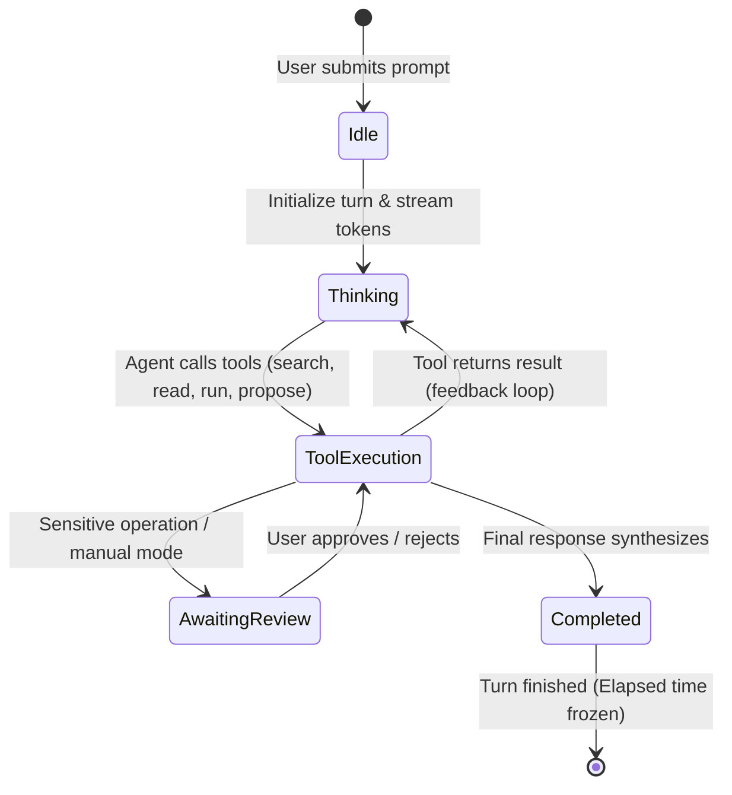

# Antigravity IDE Interface Behavior, Performance & Ergonomics Specification

## 1. Executive Summary & Design Philosophy

The Google Antigravity IDE interface represents a modern standard for AI-native software engineering environments. Rather than treating an AI agent as a detached chatbot running outside the code editor, Antigravity integrates the agent directly into the developer's cognitive loop. 

The core design tenets are:
1. **Zero Disruption & In-Place Stability**: The UI never causes layout shifts, visual stutter, or unexpected viewport jumping while the model is thinking or executing tools.
2. **User Interaction Invariance**: User gestures (collapsing a drawer, scrolling up to inspect previous output, selecting diff hunks) are strictly preserved across streaming updates and background event loops. The agent never overrides explicit user intent.
3. **Progressive Disclosure**: Detailed execution mechanics (lexical retrieval matches, shell stdout, file reads) are tucked beneath clean, scannable hierarchies that unfold on demand without cluttering the primary conversation flow.
4. **Autonomous Trust with Hard Boundary Safety**: Repetitive, safe operations (reading source files, executing test suites like `pytest`, applying workspace diffs) run autonomously without prompt fatigue, while sensitive assets (`.env`, credentials, SSH keys, private tokens) enforce strict human checkpoints.

---

## 2. Dynamic Lifecycle of the Agent Execution Trace

In Antigravity, an agent turn does not dump raw tool outputs or intermediate text into the main message feed. Instead, it follows a structured hierarchical lifecycle:



### 2.1 State Transitions and Visual Indicators

| State | Summary Header Display | Body Contents | Default Open State |
| :--- | :--- | :--- | :--- |
| **Thinking** | `Thinking… ▾` or `Thinking (Xs)… ▾` with subtle pulse | Real-time reasoning effort, initial intent formation | Open by default until user collapses |
| **Tool Execution** | `Thinking (Xs)… ▾` (or `Working… ▾`) | Nested subgroup: `Explored files, ran commands, edited files ▾`<br>Individual steps with language tags (`py`, `js`, `sh`) and chevrons (`›`) | Open by default; stays collapsed if user closes it |
| **Awaiting Review** | `Needs Review ▾` | Specific hunk diffs or command confirmation card | Automatically expands to request human action |
| **Completed** | `Worked for <time> ▾` (e.g. `Worked for 3m ▾` or `Worked for 14s ▾`) | Completed hierarchical trace of all actions taken during the turn | Collapsed or summary view; preserves user state |

---

## 3. User Reaction & Interaction Memory Model

### 3.1 The Collapse/Expand Invariant (The "Never Reopen" Rule)
In an agentic loop, model output tokens and tool event streams arrive asynchronously (often dozens of updates per second). 

- **The Problem**: A naive reactive UI re-renders the active message row on every state change and forces `<details open="true">`. When a developer clicks the twisty/arrow to collapse the thinking section, the next event (such as a file read or command execution) recreates the DOM element, blowing away the user's toggle and forcing it open again.
- **Antigravity Ergonomic Rule**:
  1. **User Intent Flag**: Whenever the user clicks `<summary>` to close a `<details>` element (detected via native `'toggle'` event or click handler), the UI marks `userCollapsed = true` for that turn.
  2. **DOM Node Continuity**: The active message and its `.work-trace` `<details>` element must be **updated in place** rather than destroyed and rebuilt. Appending new step rows or updating the timer text directly mutates the existing element, leaving the user-controlled `.open` state intact.
  3. **No Overrides**: Background tool starts, completions, and token deltas MUST NEVER set `trace.open = true` if `userCollapsed === true`.

### 3.2 Scroll Anchoring & Viewport Lock
- When the agent is outputting text or executing commands, the viewport automatically scrolls to keep the latest activity in view **only if** the user's scroll position is already at or near the bottom (within $\le 160\text{px}$).
- If the user scrolls up even slightly (to read earlier instructions, review a previous diff, or inspect a trace step), the auto-scroll **locks off immediately**.
- Collapsing or expanding a `<details>` trace does not trigger a bottom scroll jump.

---

## 4. Work Trace Hierarchy & Progressive Disclosure

Antigravity organizes agent work into three distinct levels of detail:

1. **Top-Level Turn Container**:
   - `Worked for 2m 14s ▾`
   - Shows total turn wall-clock duration from start to final synthesis.
2. **Action Category Subgroup**:
   - `Explored files, ran commands, edited files ▾`
   - Dynamically summarizes the distinct verbs used during the turn based on the tools invoked:
     - Only file reads $\rightarrow$ `"Explored files"`
     - Reads + commands $\rightarrow$ `"Explored files, ran commands"`
     - Reads + edits + commands $\rightarrow$ `"Explored files, ran commands, edited files"`
3. **Atomic Step Rows**:
   - Format: `[Badge] Action description ›`
   - Badges indicate file language or operation kind:
     - `[py]` for Python files (`.py`)
     - `[js]` / `[ts]` for JavaScript/TypeScript (`.js`, `.cjs`, `.mjs`, `.ts`)
     - `[rst]` / `[md]` for documentation
     - `[json]` for configuration files
   - Action phrasing:
     - `Ran <command / check> ›`
     - `Created <file>`
     - `Edited <file>`
     - `Read <file>`
   - Chevron (`›`): Clicking an atomic step allows on-demand expansion of tool stdout, exit code, or diff details without dumping 100 lines into the chat feed.

---

## 5. Local Permissions & Autonomous Execution Ergonomics

Antigravity balances autonomy and security through four explicit tiers:

```
[ Local Permissions ]
  👁️  Request Review    (Every edit and command requires explicit human approval)
  🔒  Default           (Prompts before sensitive file writes and arbitrary commands)
  🛡️  Auto              (Automatically applies safe edits & runs safe project checks; protects secrets)
  ⚡  Turbo             (Runs all non-destructive commands & edits without pauses)
```

### 5.1 Autonomous Execution in `Auto` & `Turbo`
- **Safe Command Catalog**: Read-only operations and safe verification commands (e.g. `pytest`, `npm test`, linters, build scripts) execute immediately.
- **Safe Hunk Application**: Model proposals against non-sensitive workspace source files are validated against baseline hashes and applied seamlessly to the editor buffers.
- **Sensitive File Perimeter**:
  Even in `Turbo` mode, operations attempting to read, modify, or leak sensitive patterns (`.env*`, `credentials*`, `*secret*`, `*password*`, `*token*`, `.pem`, `.key`, `.ssh/`, `.git/`) immediately drop into `Awaiting Review` and require an explicit human click.

---

## 6. Context Evidence & Token Budget Management

- Rather than dumping 50+ lines of raw lexical match data into the chat, context evidence is presented as a clean collapsible chip:
  `📑 Context references · 11,990 / 12,000 tokens ▾`
- Clicking reveals compact file badges (`📄 src/flask/cli.py (L410–453)`).
- Never obstructs the conversation feed; preserves zero visual noise.

---

## 7. Implementation Checklist for Little Forge

To align Little Forge 100% with the Antigravity specification:
- [x] Modern chat bubbles: User messages styled as sleek rounded pills, assistant messages borderless.
- [x] 4-Tier Local Permissions selector (`Review`, `Default`, `Auto`, `Turbo`) in top header.
- [x] Autonomous test execution (`pytest`) and safe file staging without manual prompts.
- [x] Sensitive file boundary enforcement (`isSensitivePath`).
- [x] Token ceiling expansion from 4,096 to 16,384 tokens.
- [x] Elimination of CSS `fadeIn` blinking bug.
- [x] Collapsed context drawer (`📑 Context references · ... tokens ▾`).
- [ ] **Fix Trace Toggle Bug**: Preserve user collapse state (`userCollapsed = true`); update the active `.work-trace` `<details>` in place instead of re-creating and forcing `open = true`.
- [ ] **Dynamic Turn Elapsed Timer**: Replace hardcoded `14s` with dynamic elapsed time (`Thinking (Xs)…` $\rightarrow$ `Worked for <time> ▾`).
- [ ] **Interactive Step Chevron**: Allow toggling individual step rows to inspect tool details/output.
- [ ] **Subgroup Collapsibility**: Ensure `.work-subgroup` can also be collapsed/expanded independently without reset.
